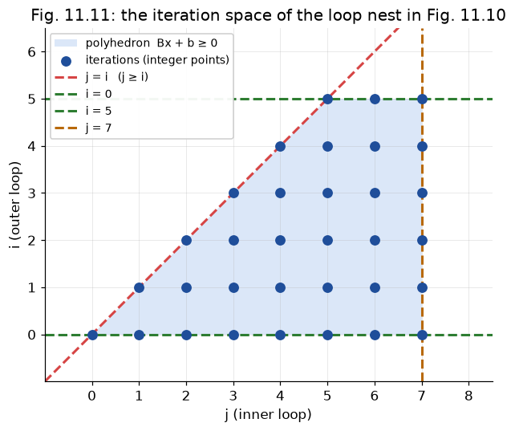

# §11.3.1 Constructing Iteration Spaces from Loop Nests

Part of [11.3 Iteration Spaces](../README.md) · next: [§11.3.2](11.3.2_execution_order.md)

**What kind of loops are allowed.** The technique needs a loop nest where

* each loop has **one index variable**, incremented by **exactly 1**;
* each lower/upper bound is an **affine expression of outer indices and symbolic constants**.

"Affine expression of outer indices" has a direction built in: the bounds of the *inner* loop may use the index of the *outer* loop (`j` runs from `i` in Fig. 11.10), but the bounds of the outer loop may not use the inner index, because that index does not exist yet when the outer loop starts. So the bounds form a triangle of dependences: the first loop's bounds use only constants and symbolic constants, the second loop's bounds may also use the first index, and so on. Each bound must also be affine, that is, a sum of integer multiples of the outer indices and symbolic constants plus a constant: the book's own example (p. 789) is `c*i + a` with literal integers `c` and `a`, and in general a bound looks like `c1*i + c2*j + c3*n + a`, so `2*i + 1`, `n - i` and `i + j - 3` are all fine. Anything else is ruled out: products of indices (`i*j`, `i*i`), a symbolic constant times an index (`n*j`), an array element (`a[i]`), or a function call.

Anything else must first be rewritten or over-approximated. "Over-approximated" means: describe a *superset* of the real iterations. That keeps every later conclusion sound (an iteration that never happens cannot invalidate a transformation), it just makes the description less precise.

| Original | Fix | Why |
|---|---|---|
| `for (i = 2; i <= 100; i += 3)` | `for (j = 0; j <= 32; j++)` with `i = 3j + 2` | stride must be 1 (Example 11.5) |
| `while (i < 100) { ...; i++; }` | `for (i = 0; i < 100; i++)` | same thing in `for` clothing (Fig. 11.9a) |
| `while (1) { ...; i++; }` | upper bound = ∞ (no upper-bound row) | we cannot know when it stops (Fig. 11.9b,c) |

The stride trick is just a change of variable: solve `c·j + a = lower` for the start, and `c·j + a ≤ upper` for the end, rounding **down** because `j` is an integer. It is the first instance of a pattern that recurs all through §11.3: *substitute, then round correctly*.

```
     i:   2    5    8   11   ...  98        (step 3)
          │    │    │    │        │
     j:   0    1    2    3   ...  32        (step 1)      i = 3j + 2,   j_max = ⌊(100−2)/3⌋ = 32
```

## Code example 01 — `./run.sh 1`

The first program checks exactly this: it runs the stride-3 loop and the unit-stride rewrite, collects the `i` values each one produces, and compares the two sequences.

**code/src/01_example_11_5_unit_stride.cpp**
```cpp
#include <cstdio>
#include <vector>

int main() {
  std::vector<long> a, b; // the i values each loop produces, in order
  for (long i = 2; i <= 100; i += 3)
    a.push_back(i); // the book's loop, stride 3
  for (long j = 0; j <= 32; j++)
    b.push_back(3 * j + 2); // the rewrite: unit stride, i = 3j + 2
  std::printf("Example 11.5 stride 3 -> unit stride: %s\n",
              a == b ? "same sequence" : "MISMATCH");
  std::printf("  i: ");
  for (long i : a)
    std::printf("%ld ", i);
  std::printf("\n");
}
```

**./run.sh 1**
```
Example 11.5 stride 3 -> unit stride: same sequence
  i: 2 5 8 11 14 17 20 23 26 29 32 35 38 41 44 47 50 53 56 59 62 65 68 71 74 77 80 83 86 89 92 95 98 
```

## Loops → inequalities → polyhedron (Example 11.6)

Each loop contributes two inequalities: `index ≥ lower` and `index ≤ upper`.

**Figure 11.10: A 2-dimensional loop nest**
```cpp
for (i = 0; i <= 5; i++)        // i ≥ 0,   i ≤ 5
    for (j = i; j <= 7; j++)    // j ≥ i,   j ≤ 7
        Z[j][i] = 0;
```

Each inequality is a half-space; the loop executes exactly the integer points in the intersection of all four half-spaces (Fig. 11.11). This intersection is a **convex polyhedron** — the key property being: *the loop bounds are the only thing that decides membership; there are no holes, dents, or disconnected pieces.*

> **Why "convex" matters.** Convexity is what allows a loop to enumerate the shape with simple `for` loops: for a fixed value of the outer index, the valid inner indices form a *single contiguous interval* `[max(lower bounds), min(upper bounds)]`. A non-convex shape (say, a C-shape) could not be swept by one inner loop with one lower and one upper bound.


