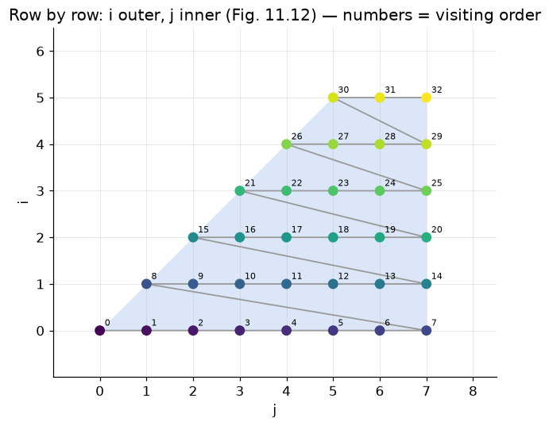

# §11.3.2 Execution Order for Loop Nests

Part of [11.3 Iteration Spaces](../README.md) · previous: [§11.3.1](11.3.1_constructing_iteration_spaces.md) · next: [§11.3.3](11.3.3_matrix_formulation.md)

**Execution order is *separate* from the shape.** The polyhedron says *which* points are executed; it says nothing about *when*. A sequential loop nest visits its points in **lexicographic order** of the index vector `[outer index, …, inner index]`. The book's definition (page 791): `i ≺ i'` ("`i` comes before `i'`") if and only if the two vectors agree in their first `m` components (`m = 0` allowed) and differ in component `m + 1` with `i_{m+1} < i'_{m+1}`. In words: compare the outer indices first; only on a tie look at the next index inward. It is the order in which words appear in a dictionary, hence the name.

Why does a loop nest produce exactly this order? The outer loop fixes `i`, and while it stays fixed the inner loop runs through every `j`. So all points with `i = 0` come before all points with `i = 1`, and within one value of `i` the points are sorted by `j`. Two consequences that trip people up:

* `[1, 7]` runs **before** `[2, 2]`, although `7 > 2`: the outer index decides, and `1 < 2`.
* The order depends on which variable is *outer*. The same point set in the order `[j, i]` (Example 11.14 in [§11.3.5](11.3.5_controlling_execution_order.md)) is a different sequence: `[0,0], [0,1], [1,1], [0,2], …`, now written as `[i, j]` pairs.

Example 11.7 lists the order for Fig. 11.10 (`i` outer). Each row of the listing is one trip of the outer loop:

**Figure 11.12: Iteration order for loop nest of Fig. 11.10**
```
[0,0], [0,1], [0,2], [0,3], [0,4], [0,5], [0,6], [0,7]
       [1,1], [1,2], [1,3], [1,4], [1,5], [1,6], [1,7]
              [2,2], [2,3], [2,4], [2,5], [2,6], [2,7]
                     [3,3], [3,4], [3,5], [3,6], [3,7]
                            [4,4], [4,5], [4,6], [4,7]
                                   [5,5], [5,6], [5,7]
```



The plot numbers each point with its position in this sequence and joins consecutive points with a line, so the sweep is visible: left to right along a row, then jump to the start of the next row up.

Keeping "shape" and "order" separate is the whole point of [§11.3.5](11.3.5_controlling_execution_order.md): a loop transformation keeps the shape and chooses a different order, that is, a different variable (or a different combination of variables) to be outermost. Which orders are *allowed* is the subject of data dependences in §11.6; this section only asks how to generate the loops once an order has been chosen.
