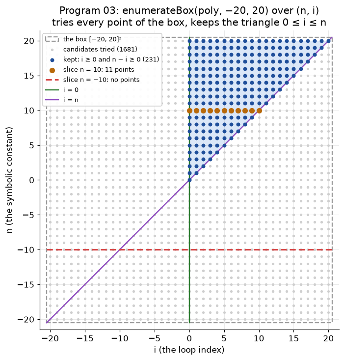

# §11.3.4 Incorporating Symbolic Constants

Part of [11.3 Iteration Spaces](../README.md) · previous: [§11.3.3](11.3.3_matrix_formulation.md) · next: [§11.3.5](11.3.5_controlling_execution_order.md)

**Symbolic constants are just more columns.** `for (i = 0; i <= n; i++)` has bounds `i ≥ 0`, `i ≤ n`. `n` is unknown, so it must be a *variable* in the algebra — but it is not a loop index, so no loop is ever generated for it. The vector becomes `(i, n)`:

```
   ┌ 1   0 ┐ ┌ i ┐   ┌ 0 ┐
   │       │ │   │ + │   │ ≥ 0          i ≥ 0,   −i + n ≥ 0
   └ −1  1 ┘ └ n ┘   └ 0 ┘
```

This is Example 11.9 in the book, which writes the index vector as `[i, n]` and the matrix as `[[1, 0], [−1, 1]]`, exactly the rows above. The book then says that only the first component, `i`, is part of the **output**, i.e. of the set of points that make up the iteration space; `n` is an *input*: whatever value it has when the nest starts is fixed for the whole nest, and no loop is generated for it.

One consequence is visible already. The two rows together force `n ≥ 0` (if `0 ≤ i ≤ n` has any solution, then `n ≥ 0`), a condition that mentions only the symbolic constant. Such a condition is not a bound on any loop index; it says whether the nest executes *at all*. For `for (i = 0; i <= n; i++)` the `for` already handles `n < 0` by running zero times; program 03 below checks both cases. How loop bounds are derived from the rows when `n` is one of the columns is the subject of [§11.3.5](11.3.5_controlling_execution_order.md).

## Code example 03 — `./run.sh 3`

**Where this happens in the code.** Neither the shared headers nor the example program have a special type for symbolic constants. Program 03 is program 02 again with Example 11.9 in place of Fig. 11.10: build the polyhedron with `n` as an ordinary column, enumerate its integer points once, and then for two values of `n` count the points two ways, by running the loop with that `n` and by taking the slice of the brute-force set whose `n` coordinate has that value. Two values are tried. `n = -10` violates the row `n ≥ 0` discussed above, so the polyhedron must be empty and the loop must run zero times. `n = 10` satisfies it, and both counts must be 11.

**code/src/03_example_11_9_symbolic_constant.cpp**
```cpp
#include "enumerate.h"

int main() {
  Polyhedron poly; // Example 11.9:  for (i = 0; i <= n; i++)
  poly.vars = {"n", "i"};
  poly.addInequality({{"i", 1}}, 0)             //  i     >= 0     i >= 0
      .addInequality({{"n", 1}, {"i", -1}}, 0); //  n - i >= 0     i <= n
  printRows(poly, "Example 11.9: symbolic constant n is just another column");

  // Brute force over (n, i). enumerateBox uses the same lo..hi for every
  // column, so the box is the square [-20, 20]^2: n from -20 to 20 and i from
  // -20 to 20, 41 * 41 = 1681 candidate points, from the corner (-20, -20) to
  // (20, 20). A candidate is kept only if both rows hold, so what comes back
  // is the triangle 0 <= i <= n <= 20 (231 points), for every n at once. As in
  // program 02 the box only has to CONTAIN the points asked about below, the
  // n values -10 and 10 with i = 0..10; a bigger box would keep more points
  // with n > 20 but change neither slice. Figure 03 in the guide draws it.
  std::set<Point> points = enumerateBox(poly, -20, 20);

  for (long value : {-10L, 10L}) {
    std::cout << "\n---- n = " << value << " ----\n";
    // The guard the book derives (Sec. 11.3.4): the nest runs at all only if
    // n >= 0. For a single loop the `for` itself enforces it.
    std::cout << "  guard n >= 0: " << (value >= 0 ? "true" : "FALSE") << "\n";

    long byLoop = 0; // count the iterations by running the loop with this n
    for (long i = 0; i <= value; i++)
      byLoop++;

    long byPoly = 0; // count the points of the slice n == value
    for (const Point &p : points)
      if (p[0] == value) // p = (n, i): column 0 is n
        byPoly++;

    std::cout << "  for (i = 0; i <= n; i++) with n = " << value << ": "
              << byLoop << " iterations\n";
    std::cout << "  integer points with n = " << value
              << " (brute force): " << byPoly << "  "
              << (byPoly == byLoop ? "== loop" : "MISMATCH") << "\n";
  }
}
```

Line by line:

* `poly.vars = {"n", "i"}` declares the polyhedron over **two** variables, `n` first. The order of this list is the column order of `B`, so the vector is `(n, i)` here where the book writes `(i, n)`; that changes nothing but the column order.
* `.addInequality({{"i", 1}}, 0)` adds the row `i ≥ 0`; `.addInequality({{"n", 1}, {"i", -1}}, 0)` adds `n − i ≥ 0`. These are the two rows of the matrix above, built exactly as program 02 built the rows of Fig. 11.10.
* `enumerateBox(poly, -20, 20)` is the same brute force as in program 02, now over the two columns `(n, i)`. Because `n` is a column, the result is the set of **all** `(n, i)` pairs in the box that satisfy both rows, for every `n` from −20 to 20 at once. The box has to contain `n = ±10` and `i = 0 … 10`, which `[−20, 20]²` does.
* Giving `n` a value is then just taking a slice: the loop over `points` counts the pairs whose first coordinate (`p[0]`, column `n`) equals the value. With `n = −10` the rows demand `0 ≤ i ≤ −10`, which no integer satisfies, so the slice is empty, exactly what the guard `n ≥ 0` predicted. With `n = 10` the slice is `i = 0 … 10`, 11 points. The loop count comes from the plain C++ loop `for (i = 0; i <= n; i++)` with that `n`.

The picture below is that call. `enumerateBox` takes one `lo` and one `hi` and applies them to every column, so the box is the square `[−20, 20]²` over `(n, i)`, from the corner `(−20, −20)` to `(20, 20)`: 41 × 41 = 1681 candidates (gray). A candidate survives only if both rows hold, and those are the blue triangle `0 ≤ i ≤ n ≤ 20`, 231 points, every `n` at once. Fixing `n` is reading one horizontal line of the picture: `n = 10` is the orange line of 11 points, `n = −10` the red dashed line that crosses no blue point at all. A bigger box would add blue points above `n = 20` and change neither line.



**./run.sh 3**
```
Example 11.9: symbolic constant n is just another column  (vars: n i )
    i >= 0
    n - i >= 0

---- n = -10 ----
  guard n >= 0: FALSE
  for (i = 0; i <= n; i++) with n = -10: 0 iterations
  integer points with n = -10 (brute force): 0  == loop

---- n = 10 ----
  guard n >= 0: true
  for (i = 0; i <= n; i++) with n = 10: 11 iterations
  integer points with n = 10 (brute force): 11  == loop
```

How the symbolic loop `for (i = 0; i <= n; i++)` itself is generated from the polyhedron over `(n, i)` is shown in [§11.3.5](11.3.5_controlling_execution_order.md); how the programs pass a symbolic constant to the shared driver is noted under [experiment.h in the code bundle](code_bundle.md#experimenth).
