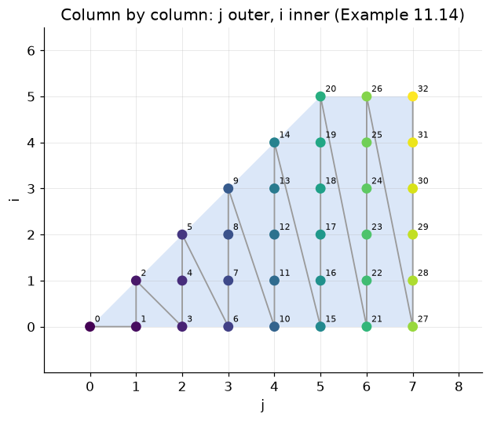
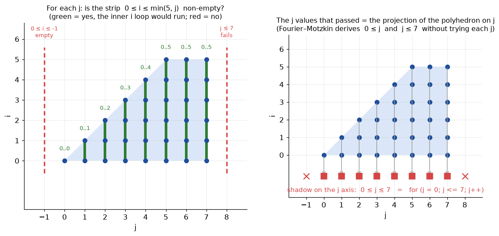
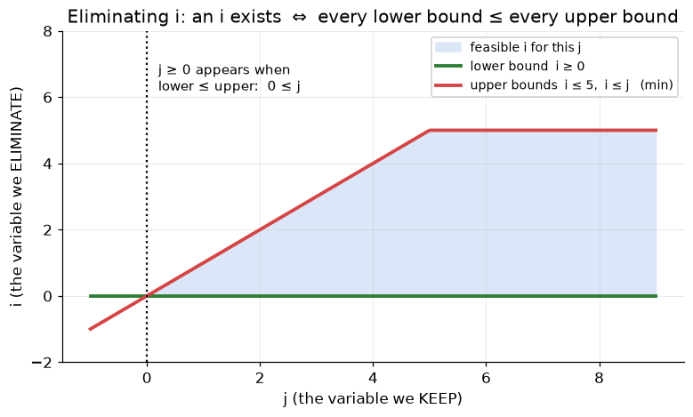
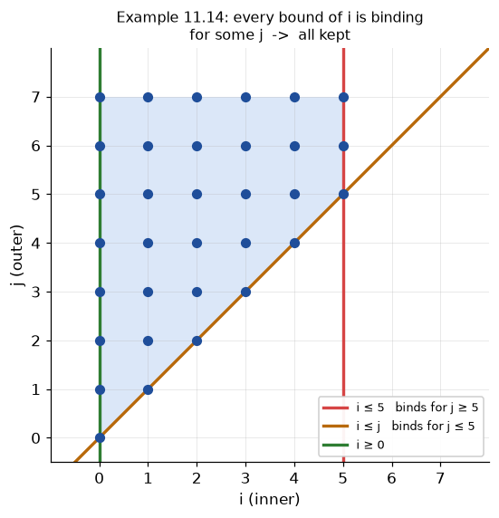

# §11.3.5 Controlling the Order of Execution

Part of [11.3 Iteration Spaces](../README.md) · previous: [§11.3.4](11.3.4_symbolic_constants.md) · next: [§11.3.6](11.3.6_changing_axes.md)

*From a polyhedron back to a loop nest.* §11.3.1 to §11.3.4 went one way: loop nest → polyhedron. This subsection goes back. Given the polyhedron and a *new* order of the index variables, produce a loop nest that visits exactly the same points, now in lexicographic order of the new variable order. The book builds this in three steps, and this guide follows them:

1. **Example 11.10** shows why anyone would want to: the same points in a different order can be much friendlier to the cache.
2. **Algorithm 11.11 (Fourier–Motzkin elimination)** is the one mathematical tool needed: it computes the bounds of an outer variable by "projecting away" the inner ones.
3. **Algorithm 11.13** wraps it into a procedure that produces the complete nest, then removes redundant bounds.

The hard part is only the outer loop's bounds; the inner loop is bookkeeping. The subsection *Why the inner loop is easy and the outer loop is hard* below explains that asymmetry before the algorithms are introduced.

## Example 11.10 — the motivating example

The book first notes that the iterations of Fig. 11.10 have **no dependences** on each other (each one writes a different element of `Z` and reads nothing), so they may be executed in any order, sequentially or in parallel. That freedom is worth using, because the original order is bad for the cache.

Why bad: C stores a 2-D array row by row, so `Z[j][i]` and `Z[j][i+1]` are neighbours in memory, while `Z[j][i]` and `Z[j+1][i]` are a whole row apart. In Fig. 11.10 the array is accessed as `Z[j][i]` with `j` the *row* index, and the inner loop varies `j`. So consecutive iterations touch consecutive *rows*: each step jumps a full row length in memory, which is the access pattern of Fig. 11.14(a). Contiguous words are visited consecutively, as in Fig. 11.14(b), only if the inner loop varies `i` instead. That means `j` must become the outer loop, and the points are then visited in the order of Fig. 11.14(c), which the book describes as sweeping the iteration space "vertically" (column by column in the orientation of Fig. 11.11). The *set* of iterations is unchanged; only the order is:

```
 j outer (Fig. 11.14c):  [0,0]  [0,1] [1,1]  [0,2] [1,2] [2,2]  [0,3] [1,3] [2,3] [3,3]  ...
                         ─ j=0  ── j=1 ───  ──── j=2 ─────  ──────── j=3 ────────
```



The book just states the answer:

```c
for (j = 0; j <= 7; j++)
    for (i = 0; i <= min(5, j); i++)
        Z[j][i] = 0;
```

The question §11.3.5 answers: **how does a compiler compute these bounds mechanically?**

## Why the inner loop is easy and the outer loop is hard

Take the inner loop first. `i` is inner, so its bounds may mention `j`. Collect every inequality that mentions `i` and solve for `i`:

```
   i ≥ 0            (lower)
   i ≤ 5            (upper)          →   for (i = max(0); i <= min(5, j); i++)
   i ≤ j            (upper)
```

That was pure bookkeeping. Now the outer loop: `j`'s bounds **may not mention `i`** — `i` does not exist yet when the `j` loop starts. The original inequalities on `j` are `j ≥ i` and `j ≤ 7`; the first one is useless as written. What we need is:

> the set of `j` values for which **some** valid `i` exists.

## Projection: the question the outer loop asks, one column at a time

Think of the outer loop as trying candidate values of `j` one by one. For a fixed `j` the inner loop would run over the strip `max(lower bounds) ≤ i ≤ min(upper bounds)`, here `0 ≤ i ≤ min(5, j)`, provided the row `j ≤ 7` holds. The outer loop should visit `j` **exactly when that strip is non-empty**: a `j` with an empty strip would be an iteration of the outer loop that does nothing, and a `j` with a non-empty strip that is skipped would lose points. Try it for a few values of `j`:

| `j` | row `j ≤ 7` | strip `0 ≤ i ≤ min(5, j)` | non-empty? | the outer loop should … |
|---|---|---|---|---|
| −1 | true | `0 ≤ i ≤ −1` | no, `0 > −1` | skip it |
| 0 | true | `0 ≤ i ≤ 0` | yes, `{0}` | visit it |
| 3 | true | `0 ≤ i ≤ 3` | yes, `{0, 1, 2, 3}` | visit it |
| 7 | true | `0 ≤ i ≤ 5` | yes, `{0, …, 5}` | visit it |
| 8 | **false** | – | no | skip it |

The left panel below is this table for every `j` from −1 to 8: a green bar is a non-empty strip (the inner `i` loop would run), a red dashed line is a `j` with nothing in it. The right panel drops every point onto the `j` axis. The `j` values that received at least one point are the **projection**, or shadow, of the polyhedron on the `j` axis: `{0, 1, …, 7}`. Those, and only those, are the values the outer loop must visit, so the shadow *is* the bound of the `j` loop: `for (j = 0; j <= 7; j++)`.



**Where Fourier–Motzkin comes in.** The table above was built by trying each `j`, which a compiler cannot do: `j` may range over thousands of values, and with symbolic constants (§11.3.4) the range is not even known. What is needed is the shadow written as *inequalities in `j`*, without trying anything. Look at the "non-empty?" column: the strip is non-empty exactly when its lower end is at most its upper end,

```
    0 ≤ min(5, j)      ⇔      0 ≤ 5   and   0 ≤ j
```

and that is a condition on `j` alone, true for `j = 0, 3, 7` and false for `j = −1`, just as the table says. Fourier–Motzkin elimination is the rule that produces this condition mechanically: pair every lower bound of `i` with every upper bound of `i` and write "lower ≤ upper". The variable `i` disappears from each pair, and what is left (`0 ≤ 5`, which is always true, and `0 ≤ j`), together with the rows that never mentioned `i` (`j ≤ 7`), describes the shadow: `0 ≤ j ≤ 7`. In short:

```
    projection (geometry)            =   shadow of the polyhedron on the remaining axes
    Fourier–Motzkin (algebra)        =   the same shadow, as inequalities, obtained by eliminating one variable
    outer loop bounds (code)         =   those inequalities, solved for the outer variable
```

## Algorithm 11.11 — Fourier–Motzkin elimination: the idea

A value of `x` exists that satisfies a set of lower bounds `L₁ ≤ x, L₂ ≤ x, …` and upper bounds `x ≤ U₁, x ≤ U₂, …` **if and only if** every lower bound is ≤ every upper bound:

```
      L₁ ─┐
      L₂ ─┼──  max(L) ≤ x ≤ min(U)  ──┬─ U₁       exists  ⇔  max(L) ≤ min(U)  ⇔  Lₐ ≤ U_b for ALL pairs (a,b)
      L₃ ─┘                           └─ U₂
```

So: *replace every (lower, upper) pair by the inequality "lower ≤ upper"*. The variable `x` cancels, and what remains is a condition on the other variables — the shadow.

Try it on Fig. 11.10 with `x = i`. The rows that mention `i` are one lower bound and two upper bounds:

```
lower bound:    0 ≤ i        (from  i ≥ 0)
upper bound 1:  i ≤ 5        (from  −i + 5 ≥ 0)
upper bound 2:  i ≤ j        (from  −i + j ≥ 0)
```

An `i` squeezed between a lower bound `L` and an upper bound `U` exists exactly when `L ≤ U`. So every (lower, upper) pair yields one condition `L ≤ U` that no longer mentions `i`:

| pair | condition `L ≤ U` | meaning |
|---|---|---|
| `0 ≤ i` with `i ≤ 5` | `0 ≤ 5` | always true, carries no information; the eliminator prints it as `5 >= 0 [always true, dropped]` |
| `0 ≤ i` with `i ≤ j` | `0 ≤ j` | the real condition on `j` |

The first condition contains no variable at all because neither of its two rows mentioned `j`; it is just the number `0` written against the number `5`. Check the second with concrete values. For `j = 3` it reads `0 ≤ 3`, true, so some `i` exists (indeed `i ∈ {0, 1, 2, 3}`), and `j = 3` is in the shadow. For `j = −1` it reads `0 ≤ −1`, false: no `i` exists, and `j = −1` is outside the shadow. Written for all `j` at once, `0 ≤ j` *is* the lower bound of the `j` loop.

**What the output of an elimination contains.** What gets eliminated is one *variable*, together with every row that mentions it. Those rows are replaced by the pairwise combinations, which mention only the remaining variables; rows that never mentioned the variable pass through untouched:

```
    S' = (rows of S that do not mention x)  ∪  (one row  c₂·L ≤ c₁·U  per (lower, upper) pair)
```

Nothing else survives. In particular the original bounds on `x` are gone, because `S'` is a statement about the other variables only: "for which values of the others does some `x` exist?"

*Fig. 11.10, eliminate `i`* (Example 11.12, `./run.sh 4`). First sort the rows of `S`:

| row of `S` | mentions `i`? | fate |
|---|---|---|
| `i ≥ 0` | yes, lower bound | consumed by the pairing |
| `−i + 5 ≥ 0` | yes, upper bound | consumed by the pairing |
| `−i + j ≥ 0` | yes, upper bound | consumed by the pairing |
| `−j + 7 ≥ 0` | no | copied to `S'` unchanged |

The pairing is the table above: `5 ≥ 0` is dropped, `j ≥ 0` is kept. So `S'` is

```
    -j + 7 >= 0        (passed through)
    j >= 0             (new, from the pair  0 ≤ i, i ≤ j)
```

Three rows mentioning `i` went in, none come out. `S'` says `0 ≤ j ≤ 7`: the `j` values for which the original nest has at least one `i`, i.e. the shadow of Fig. 11.10 on the `j` axis.

Fig. 11.10 has only one lower bound on `i`, so every pair here is trivial or a single-term row. The cases with two lower bounds and with a coefficient other than ±1 in the new row are walked through, with the same tables, under Exercise 11.3.5 in [§11.3.7 Exercises](11.3.7_exercises.md).

Two things "eliminated" does *not* mean:

* The variable is not removed from the table. The tool keeps the column `i` in `S'` with a 0 in every row, which is why program 04 still prints `(vars: i j)`. The book's `S'` has one variable fewer; the content is identical.
* The points are not removed. `S'` is a *projection*: every `(i, j)` of `S` has its `j` in `S'`, and every `j` in `S'` has at least one `i` back in `S`. The brute-force checks in programs 05 and 10 verify exactly that for the generated loops.

(Strictly, "exists" here means a *rational* `x`. For an *integer* `x` the condition is `⌈max(L)⌉ ≤ ⌊min(U)⌋`, which is slightly stronger; *Integers vs. rationals* at the end of §11.3.5 explains how the tool accounts for that.)



## Algorithm 11.11 — Fourier–Motzkin elimination: the recipe

**Input:** a set of inequalities `S`; a variable `x` to eliminate.
**Output:** `S'`, the projection of `S` onto all variables except `x`.

1. Split `S` into three groups:
   * `C_low`: rows with `x` coefficient `> 0`. Write each as `L ≤ c₁·x`.
   * `C_up` : rows with `x` coefficient `< 0`. Write each as `c₂·x ≤ U`.
   * `C_none`: rows not mentioning `x`.
2. For **every pair** `(L ≤ c₁x) ∈ C_low`, `(c₂x ≤ U) ∈ C_up` create `c₂·L ≤ c₁·U`.
   (If `c₁ = c₂ = 1` this is simply `L ≤ U`.)
3. Simplify: divide out common factors (see *Integers vs. rationals* at the end of §11.3.5 for the integer-aware version).
4. If any new row is a false constant (`−3 ≥ 0`) then `S` was empty — the loop never executes.
5. `S' = C_none ∪ {new rows}`. Trivially-true rows (`5 ≥ 0`) can be dropped.

Cost note: `u` lower × `v` upper bounds → at most `u·v` new rows. That can blow up over many eliminations, which is why Algorithm 11.13 has a redundancy-removal pass.

**In matrix terms it is one line of arithmetic.** Every row of the tool is written as `… ≥ 0`, so the two bounds of step 2 are the rows

```
    lower bound   L ≤ c₁·x      is the row    lo = c₁·x − L ≥ 0        (lo[x] = c₁ > 0)
    upper bound   c₂·x ≤ U      is the row    up = U − c₂·x ≥ 0        (up[x] = −c₂ < 0)
```

Multiply the lower row by `c₂`, the upper row by `c₁`, and add:

```
    c₂·lo + c₁·up  =  c₂·(c₁·x − L) + c₁·(U − c₂·x)  ≥ 0
                   =  c₂c₁·x − c₂·L + c₁·U − c₁c₂·x  ≥ 0        the two x terms cancel
                   =  c₁·U − c₂·L                    ≥ 0
                   ⇔  c₂·L ≤ c₁·U                                 the new constraint of step 2
```

So the new row of step 2, the one that `combine()` returns and `eliminate()` appends to `S'` for this pair, is simply

```
    newRow = c₂·lo + c₁·up          (a row over the other variables; its x column is 0)
```

On Fig. 11.10 with `lo = i ≥ 0` (`c₁ = 1`, `L = 0`) and `up = −i + j ≥ 0` (`c₂ = 1`, `U = j`): `1·lo + 1·up = j ≥ 0`, which is `c₂·L ≤ c₁·U` with those values, `0 ≤ j`. This is exactly what `combine()` in `fourier_motzkin.h` does for one pair; `eliminate()` calls it for every (lower, upper) pair and keeps the result unless it is a trivially true constant row. The book does not name this step; it is the body of the "for every pair" instruction of Algorithm 11.11 (book page 796). Where each step of the book's method lives in the code:

| Algorithm 11.11, book page 796 | code |
|---|---|
| step 1: for each pair `L ≤ c₁·x_m`, `c₂·x_m ≤ U` create `c₂·L ≤ c₁·U` | `combine(lo, up, m)`: the row sum `c₂·lo + c₁·up` |
| step 2: if `c₁` and `c₂` have a common factor, divide it out | the `normalize()` call at the end of `combine()` (which also floors the constant; see *Integers vs. rationals*) |
| step 3: an unsatisfiable new constraint means `S` and `S'` are empty | `eliminate()` keeps such a row (e.g. `−3 ≥ 0`); `infeasible()` and `computeBounds()` test for it |
| step 4: `S' = (S − C)` plus the new constraints | the three-pile sort and the pairing loop in `eliminate()` |

The worked instance is Example 11.12 (book page 797), which program 04 reproduces step by step; `combine()` and the pairing loop are quoted in [the code bundle](code_bundle.md#fourier_motzkinh).

## Example 11.12 — worked by hand and by the program

The book (p. 797) states the example in three sentences: project the iteration space of Fig. 11.10 (its picture is the book's Fig. 11.11, figure 01 in [§11.3.1](11.3.1_constructing_iteration_spaces.md)) away from the `i` dimension and onto the `j` dimension; there is one lower bound on `i`, `0 ≤ i`, and two upper bounds, `i ≤ j` and `i ≤ 5`; this generates `0 ≤ j` and `0 ≤ 5`, the latter trivially true, the former the lower bound on `j`, while the original `j ≤ 7` gives the upper bound. Below is the same example with every step written out. The step numbers are the book's: its step 1 is the recipe's steps 1 and 2 above, and its steps 2, 3, 4 are the recipe's 3, 4, 5.

**The input.** `S` is the four rows of Fig. 11.10. The book calls the rows that involve the variable being eliminated `C`; here `C` is the first three rows and `S − C` is the last one:

| loop condition | row of `S` | coefficient of `i` | pile |
|---|---|---|---|
| `i ≥ 0` | `i ≥ 0` | `+1` | lower bound: `L = 0`, `c₁ = 1` |
| `i ≤ 5` | `−i + 5 ≥ 0` | `−1` | upper bound: `U = 5`, `c₂ = 1` |
| `j ≥ i` | `−i + j ≥ 0` | `−1` | upper bound: `U = j`, `c₂ = 1` |
| `j ≤ 7` | `−j + 7 ≥ 0` | `0` | not in `C`: passes through untouched |

**Book step 1: one new constraint per (lower, upper) pair.** One lower bound times two upper bounds is two pairs, and `c₂·L ≤ c₁·U` for each. In row form the same thing is `c₂·lo + c₁·up`; the notation `[aᵢ aⱼ | c]` below means the row `aᵢ·i + aⱼ·j + c ≥ 0`, i.e. one row of `B` and `b` in Eq. 11.1:

| pair | `c₂·L ≤ c₁·U` | the same as row arithmetic | new row |
|---|---|---|---|
| `0 ≤ i` with `i ≤ 5` | `1·0 ≤ 1·5`, i.e. `0 ≤ 5` | `[1 0 \| 0] + [−1 0 \| 5] = [0 0 \| 5]` | `5 ≥ 0` |
| `0 ≤ i` with `i ≤ j` | `1·0 ≤ 1·j`, i.e. `0 ≤ j` | `[1 0 \| 0] + [−1 1 \| 0] = [0 1 \| 0]` | `j ≥ 0` |

The `i` column is `0` in both sums. That cancellation is the only reason the two rows are added, and it is what the words "project away `i`" mean mechanically.

**Book step 2: common factors.** `c₁ = c₂ = 1` in both pairs, so there is nothing to divide. (A pair where it matters is in Exercise 11.3.5, part (c), and the subsection *Integers vs. rationals* below shows what the integer version of this step adds.)

**Book step 3: is a new constraint unsatisfiable?** `5 ≥ 0` has no variable and is true. `j ≥ 0` has a variable, so by itself it is neither true nor false. There is no false constant, so `S` is not empty. Had the loop read `for (i = 6; i <= 5; i++)`, the first pair would have produced `6 ≤ 5`, i.e. `−1 ≥ 0`, and the algorithm would stop here with the verdict "`S` is empty".

**Book step 4: assemble `S'`.** `S' = (S − C) ∪ {new constraints}`, with the trivially true `5 ≥ 0` left out:

```
    -j + 7 >= 0        (S − C: passed through)
    j >= 0             (new, from the pair  0 ≤ i, i ≤ j)
```

Three rows that mention `i` went in and none came out; of the two pairs, one produced a real row. `S'` says `0 ≤ j ≤ 7`: the shadow of the trapezoid on the `j` axis, which is the range of the outer loop when `j` is outermost (Example 11.14).

**Reading `i` back from `S'`.** Right after the algorithm the book adds: given a solution in `S'`, the range of the eliminated variable is found by replacing all other variables in `C` by their actual values. For `j = 3`, `C` becomes `0 ≤ i`, `i ≤ 5`, `i ≤ 3`, so `i` runs over `0..3`. For `j = 8`, `C` becomes `0 ≤ i`, `i ≤ 5`, `i ≤ 8`, so `i` would run over `0..5`, yet `j = 8` is not in `S'`, because of the row that passed through, `j ≤ 7`. Both halves matter: `C` gives the inner loop, `S'` the outer one, and that is exactly how Algorithm 11.13 will use them. Program 04 runs this check for every `j` from `−1` to `8` (the per-`j` block of its output): the `j` values that have at least one integer `i` are exactly the ones `S'` admits.

Notice how `j ≥ i`, which was a *lower bound on `j`* in the original program, became `j ≥ 0` after elimination. Different bound, same shadow.

### Code example 04 — `./run.sh 4`

Program 04 (`code/src/04_example_11_12_eliminate_i.cpp`) does the same elimination with verbose tracing on, so every pair tried is printed, and then brute-forces the per-`j` check: for each `j` it lists the integer `i` values of `S` on that `j` (from `enumerateBox`) and asks whether `S'` admits that `j`. Because the `i` column of every row of `S'` is `0`, `contains(shadow, {0, j})` tests `j` alone.

`combine()` and the pairing loop of `eliminate()`, the code that prints the trace below, and the `isConstant()` helper it uses, are quoted and explained in [the code bundle](code_bundle.md#fourier_motzkinh).

**code/src/04_example_11_12_eliminate_i.cpp**
```cpp
#include "verify.h"

int main() {
  Polyhedron poly; // Fig. 11.10:  for (i=0;i<=5;i++) for (j=i;j<=7;j++)
  poly.vars = {"i", "j"};
  poly.ge0({{"i", 1}}, 0)            //  i     >= 0     i >= 0
      .ge0({{"i", -1}}, 5)           // -i + 5 >= 0     i <= 5
      .ge0({{"i", -1}, {"j", 1}}, 0) // -i + j >= 0     j >= i
      .ge0({{"j", -1}}, 7);          // -j + 7 >= 0     j <= 7
  std::cout << "Example 11.12: project away i (verbose)\n";
  Polyhedron shadow = eliminate(poly, poly.column("i"), true);
  printRows(shadow, "  result");

  // Brute force: every integer point of S in a box around the shape.
  std::set<Point> points = enumerateBox(poly, -2, 12);
  std::cout << "\nper-j check: which j have an integer i in S, and does S' "
               "admit exactly those?\n";
  bool allOk = true;
  for (int64_t j = -1; j <= 8; ++j) {
    std::vector<int64_t> is; // the i values of S on this j (set order = sorted)
    for (const Point &p : points)
      if (p[1] == j)
        is.push_back(p[0]);
    bool exists = !is.empty();
    // The i column of every row of S' is 0, so any i (here 0) can stand in.
    bool admitted = contains(shadow, Point{0, j});
    std::cout << "  j = " << std::setw(2) << j << ":  ";
    if (exists)
      std::cout << "i in " << is.front() << ".." << is.back() << "  ("
                << is.size() << (is.size() == 1 ? " value) " : " values)");
    else
      std::cout << "no integer i         ";
    std::cout << "   S' admits j: " << (admitted ? "yes" : "no ") << "   "
              << (admitted == exists ? "OK" : "MISMATCH") << "\n";
    allOk = allOk && (admitted == exists);
  }
  std::cout << "  verify: S' admits exactly the j that have some i: "
            << (allOk ? "IDENTICAL" : "MISMATCH") << "\n";
}
```

**./run.sh 4**
```
Example 11.12: project away i (verbose)
  eliminating i: 1 lower bound(s), 2 upper bound(s) -> at most 2 new rows
    (i >= 0)  x  (-i + 5 >= 0)  =>  5 >= 0   [always true, dropped]
    (i >= 0)  x  (-i + j >= 0)  =>  j >= 0
  result  (vars: i j )
    -j + 7 >= 0
    j >= 0

per-j check: which j have an integer i in S, and does S' admit exactly those?
  j = -1:  no integer i            S' admits j: no    OK
  j =  0:  i in 0..0  (1 value)    S' admits j: yes   OK
  j =  1:  i in 0..1  (2 values)   S' admits j: yes   OK
  j =  2:  i in 0..2  (3 values)   S' admits j: yes   OK
  j =  3:  i in 0..3  (4 values)   S' admits j: yes   OK
  j =  4:  i in 0..4  (5 values)   S' admits j: yes   OK
  j =  5:  i in 0..5  (6 values)   S' admits j: yes   OK
  j =  6:  i in 0..5  (6 values)   S' admits j: yes   OK
  j =  7:  i in 0..5  (6 values)   S' admits j: yes   OK
  j =  8:  no integer i            S' admits j: no    OK
  verify: S' admits exactly the j that have some i: IDENTICAL
```

## Algorithm 11.13 — Loop-bound generation

Given a variable order `v₁ (outermost), v₂, …, vₙ (innermost)`, the algorithm has two passes. The figure below is Fig. 11.15 redrawn as data flow:

```
   Pass 1: inner → outer (projection)                     Pass 2: outer → inner (pruning)

   Sₙ = S  ───┐                                            S' = ∅
              │ record L_vₙ, U_vₙ (rows mentioning vₙ)      │
              ▼                                            ▼  for v₁: drop bounds implied by S'; add rest to S'
   Sₙ₋₁ = FM(Sₙ, vₙ)                                       │
              │ record L_vₙ₋₁, U_vₙ₋₁                       ▼  for v₂: drop bounds implied by S'; add rest to S'
              ▼                                            │
   ...                                                     ...
              ▼                                            ▼
   S₀ = only constants  (must all be ≥ 0, else empty)      emit:  for (vᵢ = max(L_vᵢ); vᵢ <= min(U_vᵢ); vᵢ++)
```

**Pass 1.** Start from the innermost variable. Its bounds may mention every outer variable, so *all* rows mentioning it are legal bounds — record them, then project it away. Now the next variable's rows only mention variables outer to it, and so on. After `n` projections only constants (and symbolic constants) are left.

**Pass 2.** FM produces many rows that are implied by others. Walk outermost-first with an accumulating set `S'` of kept bounds; drop a bound if `S'` (together with the other bounds of the same variable) already implies it.

## Pass 2: the question the pruning pass asks, one bound at a time

After Pass 1 the generated nest would already be **correct**: every recorded bound is a true inequality, and `max(...)` of all lower bounds and `min(...)` of all upper bounds visits exactly the right points. Pass 2 only makes the code **shorter**. A candidate bound that is never the tightest one is a term inside `max(...)` or `min(...)` that never wins; it costs a comparison per iteration and says nothing. So Pass 2 asks, for each candidate bound of a loop:

> Given what is already known when this loop starts (the bounds of the outer loops, `S'`, and the other bounds of this same loop), is there **any** value of the outer variables for which this bound is the binding one?

If the answer is no, the bound is dropped. On the book's own example nothing is dropped, which is the normal outcome for a small nest; a case where a bound does go is worked under Exercise 11.3.4(a) in [§11.3.7 Exercises](11.3.7_exercises.md).

*Example 11.14 (Fig. 11.10, order `j`, `i`, program 05): nothing is dropped.* The outer loop keeps `0 ≤ j ≤ 7`, so `S' = {0 ≤ j ≤ 7}`. The inner loop's candidates are `i ≥ 0`, `i ≤ 5`, `i ≤ j`. Try a few `j`:

| `j` | `min(5, j)` | binding upper bound |
|---|---|---|
| 2 | 2 | `i ≤ j` |
| 5 | 5 | both |
| 7 | 5 | `i ≤ 5` |

Each upper bound wins for some `j`, so each must stay: `for (i = 0; i <= min(5, j); i++)`. The picture: both upper-bound lines touch the shape somewhere.



**Where `implied()` comes in.** As with projection, a compiler cannot try every `j`. "Never binding" is the same as "implied by the others", and mechanically the tool asks the opposite question: can the context hold *and* the bound fail? Over the integers "`i ≤ 5` fails" is `i ≥ 6`, so it adds that row to the context `{0 ≤ j ≤ 7, i ≥ 0, i ≤ j}` and runs Fourier–Motzkin to the end, looking for a false constant. This is the trace:

```
    context:  j >= 0,  -j + 7 >= 0,  i >= 0,  -i + j >= 0
    added:    i - 6 >= 0                                   (NOT  i <= 5)

    eliminate i:   (i - 6 >= 0) x (-i + j >= 0)   =>   j - 6 >= 0        i.e.  j >= 6
                   (i >= 0)     x (-i + j >= 0)   =>   j >= 0            (already there)
    eliminate j:   (j - 6 >= 0) x (-j + 7 >= 0)   =>   1 >= 0            TRUE
                   (j >= 0)     x (-j + 7 >= 0)   =>   7 >= 0            TRUE
```

Every constant that comes out is true: the context *can* hold while `i ≤ 5` fails (`j = 7`, `i = 6`), so `i ≤ 5` is not implied and stays, exactly as the table said. The same test for `i ≤ j`, with the added row `i ≥ j + 1` and `i ≤ 5` in the context, produces `−j + 4 ≥ 0` and then only the true constants `7 ≥ 0` and `4 ≥ 0` (`j = 2`, `i = 4` is a witness), so it stays too. When a bound *is* implied, the same test ends in a false constant; the trace for one, `i ≤ 29` in Exercise 11.3.4(a), is in [§11.3.7 Exercises](11.3.7_exercises.md). In short:

```
    Pass 1 (projection)   answers  "which values may the outer loop visit?"           needed for correctness
    Pass 2 (pruning)      answers  "which recorded bounds can ever be the tightest?"  only for shorter code
    implied(context, b)   =  Fourier–Motzkin once more, on  context AND NOT(b),  looking for a false constant
```

> **Where the tool goes beyond Fig. 11.15.** The book drops a bound only if `S'` (the *outer* bounds) implies it. The tool also uses the other bounds of the *same* variable as context, which prunes more (e.g. in Exercise 11.3.4(a) it drops `i ≤ 29`, which the book's rule would keep). Both results are correct; if you follow the book by hand you will get a longer `min(...)`.
>
> One pitfall when implementing this: while deciding bound number `j`, the context must contain only bounds that are *still undecided or already kept* — never ones already dropped in the same pass. Otherwise two bounds that imply each other (FM frequently regenerates an existing row) are both removed, and a loop ends up with no upper bound at all. `code/src/90_fm_fuzz.cpp` guards against exactly this. "Implied" is tested by checking that `S' ∧ ¬bound` has no solution — and *that* test is itself FM run to completion (eliminate everything, look at the constants). The function, `implied()`, is quoted in [the code bundle](code_bundle.md#fourier_motzkinh).

**Walk-through on Example 11.14** (Fig. 11.10, new order `j` outer, `i` inner). Start with the four rows `i ≥ 0`, `i ≤ 5`, `j ≥ i`, `j ≤ 7`.

*Pass 1, innermost first.* The innermost variable is `i`. Every row that mentions `i` is a legal bound for the inner loop, because `j` is known by then: record `L_i = {0}` and `U_i = {5, j}`. Then project `i` away with Algorithm 11.11, which produces `j ≥ 0` (from the pair `0 ≤ i`, `i ≤ j`) and keeps `j ≤ 7`; call that `S₁`. Now `j` is the innermost of what is left: record `L_j = {0}`, `U_j = {7}`, project `j` away, and only the constant `7 ≥ 0` remains (`S₀`). It is true, so the nest is non-empty.

*Pass 2, outermost first.* `S'` starts empty. For `j` the candidate bounds are `0 ≤ j ≤ 7`; nothing in `S'` implies either, so both are kept and added to `S'`. For `i` the candidates are `i ≥ 0`, `i ≤ 5`, `i ≤ j`. Is `i ≤ 5` implied by `S' = {0 ≤ j ≤ 7}` plus `i ≤ j`? No: `j = 7`, `i = 6` satisfies them and violates it. Is `i ≤ j` implied by `S'` plus `i ≤ 5`? No: `j = 2`, `i = 4`. So all three stay.

*Emission.* Lower bounds go into a `max`, upper bounds into a `min`; a single bound needs neither. If a coefficient is not ±1, the bound becomes `⌈expr / c₁⌉` (lower) or `⌊expr / c₂⌋` (upper). Here that gives `for (j = 0; j <= 7; j++) for (i = 0; i <= min(5, j); i++)`, which is exactly the loop the book stated in Example 11.10.

### Code example 05 — `./run.sh 5`

The same steps as printed by program 05 (`code/src/05_example_11_14_reorder_j_i.cpp`): the pairs tried, `S_1`, `S_0`, then the recorded `L`/`U` lists, then the code and the verdict. The program also re-checks the book's hand-written loop as plain C++ (last line).

The algorithm itself, `computeBounds()`, is quoted in [the code bundle](code_bundle.md#loop_boundsh) together with a line-by-line map from Fig. 11.15 to the code, `dropImpliedBounds()` (Pass 2), the `implied()` test, and the emitter that prints the `for` lines.

Every line of the output below comes from one of the functions quoted in [the code bundle](code_bundle.md). Reading the trace with this table turns it into a walk through the code:

| line(s) of `./run.sh 5` | printed by |
|---|---|
| `==== Example 11.14: … ====` | `experiment()`, the title |
| `eliminating i: …` and each `(…)  x  (…)  =>  …` pair | `eliminate()` with `verbose` on (code example 04), called from Pass 1 of `computeBounds()` |
| `S_1 (after projecting away i)`, `S_0 (after projecting away j)` | `printRows()` in Pass 1 of `computeBounds()` |
| `redundant: …` (none in this example) | `dropImpliedBounds()` in Pass 2 of `computeBounds()` |
| `bounds (Algorithm 11.13):` with `L_j`, `U_j`, `L_i`, `U_i` | `printBounds()`, called by step 2 of `experiment()` |
| `generated code:` and the three `for` / body lines | `printGeneratedNest()` → `emit()` → `loopHeader()`, which uses `boundExprs()` and `joinMinMax()` |
| `verify …: 33 iterations, IDENTICAL point set …` and `first iterations in generated order:` | `compare()` on the points of `runNest()` mapped back with `mapBack()`, against `enumerateBox()`: steps 3 and 4 of `experiment()` |
| `plain-loop check …` and `… 33 pts  == original` | the program's own loops and `report()` |

The driver `experiment()` and the checker (`runNest`, `compare`, `report`) are quoted and explained in the code bundle, under [experiment.h](code_bundle.md#experimenth) and [verify.h](code_bundle.md#verifyh).

**code/src/05_example_11_14_reorder_j_i.cpp**
```cpp
#include "experiment.h"

int main() {
  Polyhedron poly; // Fig. 11.10:  for (i=0;i<=5;i++) for (j=i;j<=7;j++)
  poly.vars = {"i", "j"};
  poly.ge0({{"i", 1}}, 0)                 //  i     >= 0     i >= 0
      .ge0({{"i", -1}}, 5)                // -i + 5 >= 0     i <= 5
      .ge0({{"i", -1}, {"j", 1}}, 0)      // -i + j >= 0     j >= i
      .ge0({{"j", -1}}, 7);               // -j + 7 >= 0     j <= 7
  const Matrix identity2{{1, 0}, {0, 1}}; // identity: a pure reorder
  const std::vector<int64_t> zero2{0, 0};
  // experiment(title, poly, newVars, transform, offset, loopOrder, boxLo,
  // boxHi,
  //            body, verbose): newVars == poly.vars means a pure reorder
  experiment("Example 11.14: order j,i (sweep vertically)", poly, poly.vars,
             identity2, zero2, {"j", "i"}, -2, 12, "Z[j][i] = 0;", true);

  std::set<IJ> ref; // the points the original nest visits
  for (long i = 0; i <= 5; i++)
    for (long j = i; j <= 7; j++)
      ref.insert({i, j});
  std::set<IJ> got; // the book's answer, as a plain loop
  long n = 0;       // its iteration count (catches a point visited twice)
  for (long j = 0; j <= 7; j++)
    for (long i = 0; i <= std::min(5L, j); i++) {
      got.insert({i, j});
      n++;
    }
  std::cout << "\nplain-loop check of the book's answer:\n";
  report("Example 11.14  for j / for i<=min(5,j)", ref, got, n);
}
```

**./run.sh 5**
```
==== Example 11.14: order j,i (sweep vertically) ====
  eliminating i: 1 lower bound(s), 2 upper bound(s) -> at most 2 new rows
    (i >= 0)  x  (-i + 5 >= 0)  =>  5 >= 0   [always true, dropped]
    (i >= 0)  x  (-i + j >= 0)  =>  j >= 0
  S_1 (after projecting away i)  (vars: i j )
    -j + 7 >= 0
    j >= 0
  eliminating j: 1 lower bound(s), 1 upper bound(s) -> at most 1 new rows
    (j >= 0)  x  (-j + 7 >= 0)  =>  7 >= 0   [always true, dropped]
  S_0 (after projecting away j)  (vars: i j )
  bounds (Algorithm 11.13):
    L_j:  0
    U_j:  7
    L_i:  0
    U_i:  5  j
  generated code:
for (j = 0; j <= 7; j++)
  for (i = 0; i <= min(5, j); i++)
    Z[j][i] = 0;
  verify Example 11.14: order j,i (sweep vertically): 33 iterations, IDENTICAL point set to brute force (no duplicates)
  first iterations in generated order: [0,0] [0,1] [1,1] [0,2] [1,2] [2,2] [0,3] [1,3] [2,3] [3,3] ...

plain-loop check of the book's answer:
  Example 11.14  for j / for i<=min(5,j)                   33 pts  == original
```

## A subtlety the book glosses over: integers vs. rationals

FM reasons over the **rationals**. Step 2 of the book's algorithm only divides out the gcd of `c₁, c₂`. But our points are **integers**, and for integers a row can be tightened further:

```
   g·(a'·x) + c ≥ 0   and  x integer    ⇒    a'·x + ⌊c / g⌋ ≥ 0
```

Example: suppose a pair produces `−2i − 2j + 99 ≥ 0`. Rational FM says `i + j ≤ 49.5`; integer tightening says `i + j ≤ 49`. The tool applies this in `normalize()`, quoted in [the code bundle](code_bundle.md#polyh).

This is why a generated loop can say `for (i = 0; i <= 49; i++)` although the source said `i < 100`: the extra `i` values would run zero inner iterations. (Nest (c) of the exercises does exactly this; the row above is its `k` pair, and the regenerated loop is in the output of code example 10 under Exercise 11.3.4 in [§11.3.7 Exercises](11.3.7_exercises.md).) Tightened bounds are harmless for code generation and *essential* for the dependence tests of §11.6.

Also important for *writing* the generated code in C/C++: `/` truncates toward zero, so `(−1)/2 == 0`, not `−1`. The generated C therefore calls `floor_div`/`ceil_div` instead of `/`. In the test harness those are the two templated helpers of `intdiv.h`, named `floorDiv`/`ceilDiv` as in MLIR's affine utilities, and the plain-loop checks use the same two functions.

A few values make the difference concrete; the first two are the comment at the top of `intdiv.h`, and all of them were produced by the two functions:

| `a / b` | exact quotient | C++ `a / b` | `floorDiv(a, b)` | `ceilDiv(a, b)` |
|---|---|---|---|---|
| `-1 / 2` | `-0.5` | `0` | `-1` | `0` |
| `-7 / 2` | `-3.5` | `-3` | `-4` | `-3` |
| `7 / 2` | `3.5` | `3` | `3` | `4` |
| `-6 / 2` | `-3` | `-3` | `-3` | `-3` |

The two functions are quoted in [the code bundle](code_bundle.md#intdivh).
