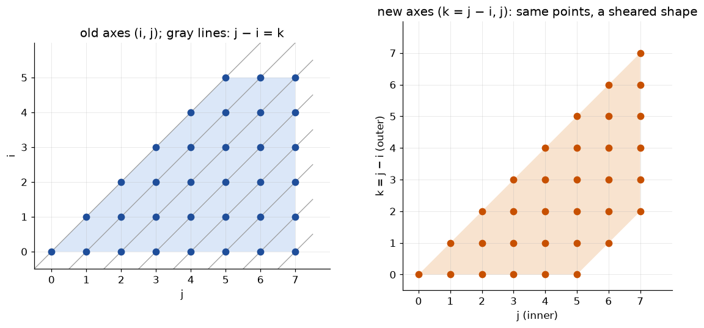
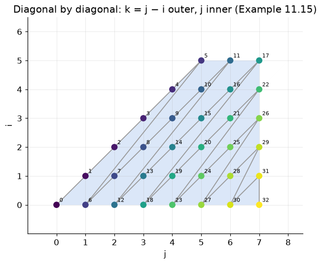

# §11.3.6 Changing Axes

Part of [11.3 Iteration Spaces](../README.md) · previous: [§11.3.5](11.3.5_controlling_execution_order.md) · next: [§11.3.7](11.3.7_exercises.md)

## Example 11.15 — the idea

Sweeping rows (`i` outer) or columns (`j` outer) are just two orders. Example 11.15 (Fig. 11.16 in the book) sweeps **diagonals**: all points with `j − i = 0`, then `j − i = 1`, and so on. No order of the *existing* variables does that, because "which diagonal" is not `i` and not `j` but their difference. So introduce a new variable `k = j − i` and make it the outer loop; the loop order is `(k, j)`, and the old index `i` is recovered in the body as `i = j − k`.

The picture below shows the same 33 points twice: on the left in the old `(i, j)` coordinates with the diagonals drawn in, on the right in the new `(k, j)` coordinates, where each diagonal has become a row. Changing axes is a *shear* of the picture, nothing more.



Nothing in Algorithm 11.13 cares about the *names* of the variables, so changing axes is just:

1. **Substitute** the old variables in terms of the new ones in every row: here `i = j − k`, `j = j`.
2. Run Algorithm 11.13 on the new system with the new order.
3. In the loop body, rewrite the old indices in terms of the new ones.

In matrix form, if `x_old = T·y_new + t`, each row `a·x + c ≥ 0` becomes `(a·T)·y + (a·t + c) ≥ 0` — one matrix multiply (function `changeAxes()` in the tool). For Example 11.15:

```
   ┌ i ┐   ┌ −1  1 ┐ ┌ k ┐   ┌ 0 ┐            i = −k + j
   │   │ = │       │ │   │ + │   │            j =      j
   └ j ┘   └  0  1 ┘ └ j ┘   └ 0 ┘
```

Step 1, substitute `i = j − k` into the four rows of Fig. 11.10 and tidy up:

```
   i ≥ 0     →   j − k ≥ 0        →    −k + j     ≥ 0
   i ≤ 5     →   j − k ≤ 5        →     k − j + 5 ≥ 0
   j ≥ i     →   j ≥ j − k        →     k         ≥ 0      (j cancels: this row is about k alone)
   j ≤ 7     →                          −j + 7    ≥ 0      (unchanged, no i in it)
```

Step 2, Algorithm 11.13 with order `(k, j)`. Innermost is `j`: its rows give `L_j = {k}` and `U_j = {k + 5, 7}`. Projecting `j` away pairs `j ≥ k` with `j ≤ k + 5` (gives `5 ≥ 0`, dropped) and with `j ≤ 7` (gives `k ≤ 7`); together with the row `k ≥ 0` that is `L_k = {0}`, `U_k = {7}`. Nothing is redundant. Step 3, emit, and replace `i` by `j − k` in the body:

```
   bounds (order k, j):   L_k: 0   U_k: 7       L_j: k   U_j: k+5, 7

   for (k = 0; k <= 7; k++)
     for (j = k; j <= min(k + 5, 7); j++)
       Z[j][j-k] = 0;              ← i replaced by j − k in the body
```

Check it against the picture: diagonal `k = 0` is the main diagonal `j = i`, which has the six points `j = 0 … 5` (`min(k + 5, 7) = 5`); diagonal `k = 7` is the single corner point `(i, j) = (0, 7)` (`j` from 7 to `min(12, 7) = 7`). Program 06 (code example 06 below) prints the same substituted rows and the same bounds, verifies the 33 points, and re-checks the book's loop as plain C++.



### Code example 06 — `./run.sh 6`

`changeAxes` and `mapBack`, the substitution and its inverse, are quoted and explained in [the code bundle](code_bundle.md#experimenth).

**code/src/06_example_11_15_change_axes.cpp**
```cpp
#include "experiment.h"

int main() {
  Polyhedron poly; // Fig. 11.10:  for (i=0;i<=5;i++) for (j=i;j<=7;j++)
  poly.vars = {"i", "j"};
  poly.ge0({{"i", 1}}, 0)            //  i     >= 0     i >= 0
      .ge0({{"i", -1}}, 5)           // -i + 5 >= 0     i <= 5
      .ge0({{"i", -1}, {"j", 1}}, 0) // -i + j >= 0     j >= i
      .ge0({{"j", -1}}, 7);          // -j + 7 >= 0     j <= 7
  const Matrix transform{
      {-1, 1}, {0, 1}}; // (i, j) = transform * (k, j) + offset:  i = j - k
  const std::vector<int64_t> offset{0, 0};
  // experiment(title, poly, newVars, transform, offset, loopOrder, boxLo,
  // boxHi,
  //            body, verbose): newVars == poly.vars means a pure reorder
  experiment("Example 11.15: k = j - i, order k,j", poly, {"k", "j"}, transform,
             offset, {"k", "j"}, -2, 12, "Z[j][j-k] = 0;", false);

  std::set<IJ> ref; // the points the original nest visits
  for (long i = 0; i <= 5; i++)
    for (long j = i; j <= 7; j++)
      ref.insert({i, j});
  std::set<IJ> got; // the book's answer, as a plain loop
  long n = 0;       // its iteration count (catches a point visited twice)
  for (long k = 0; k <= 7; k++)
    for (long j = k; j <= std::min(5 + k, 7L); j++) {
      got.insert({j - k, j});
      n++;
    }
  std::cout << "\nplain-loop check of the book's answer:\n";
  report("Example 11.15  for k / for j (i = j-k)", ref, got, n);
}
```

**./run.sh 6**
```
==== Example 11.15: k = j - i, order k,j ====
  constraints after substitution  (vars: k j )
    -k + j >= 0
    k - j + 5 >= 0
    k >= 0
    -j + 7 >= 0
  bounds (Algorithm 11.13):
    L_k:  0
    U_k:  7
    L_j:  k
    U_j:  k + 5  7
  generated code:
for (k = 0; k <= 7; k++)
  for (j = k; j <= min(k + 5, 7); j++)
    Z[j][j-k] = 0;
  verify Example 11.15: k = j - i, order k,j: 33 iterations, IDENTICAL point set to brute force (no duplicates)
  first iterations in generated order: [0,0] [1,1] [2,2] [3,3] [4,4] [5,5] [0,1] [1,2] [2,3] [3,4] ...

plain-loop check of the book's answer:
  Example 11.15  for k / for j (i = j-k)                   33 pts  == original
```

## A condition the book leaves implicit: unimodularity

You keep one old variable (`j`) and add one new one (`k`), and then recover `i = j − k`. That only works if *every integer `(k, j)` maps to an integer `(i, j)` and vice versa*, i.e. the change-of-basis matrix is **unimodular** (integer entries, determinant ±1):

```
   (i, j) → (k, j):   [k]   [−1  1] [i]        det = −1 · 1 − 1 · 0 = −1   ✓ unimodular
                      [j] = [ 0  1] [j]
```

A determinant of ±1 is exactly the condition for the inverse matrix to have integer entries, which is what "and vice versa" needs. The simplest failure is the map `k = 2i` (matrix `[[2]]`, determinant 2): every integer `i` gives an integer `k`, but the integer `k = 1` corresponds to `i = 1/2`, which is no iteration at all. A loop over `k` with unit stride would therefore visit twice as many points as exist, and half of them would be meaningless.

If you choose a non-unimodular map (e.g. `k = i − 2j` and keep `i` inner, giving `j = (i − k)/2`), some integer `(k, i)` pairs correspond to non-integer `j`, and the generated loop would need a stride or a divisibility test — outside §11.3. There are two ways out, and Exercise 11.3.8(b) in [§11.3.7](11.3.7_exercises.md) shows both: (1) do what the exercise says anyway and let the determined variable's loop run *once or not at all* (a divisibility test in disguise); or (2) keep the *other* variable inner — with `(m, j)` and `i = m + 2j` the matrix `[[1, −2],[0, 1]]` has determinant 1 and every bound is a plain `for`.
