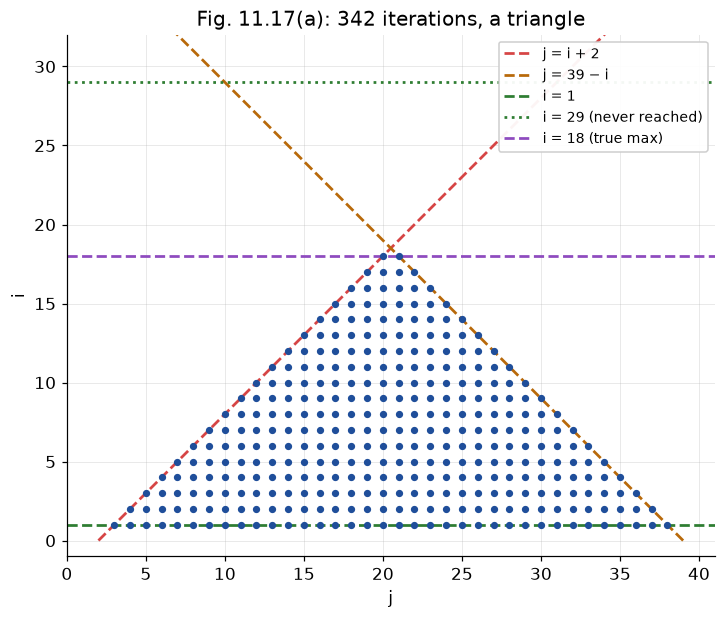
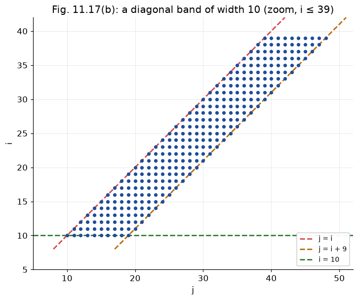
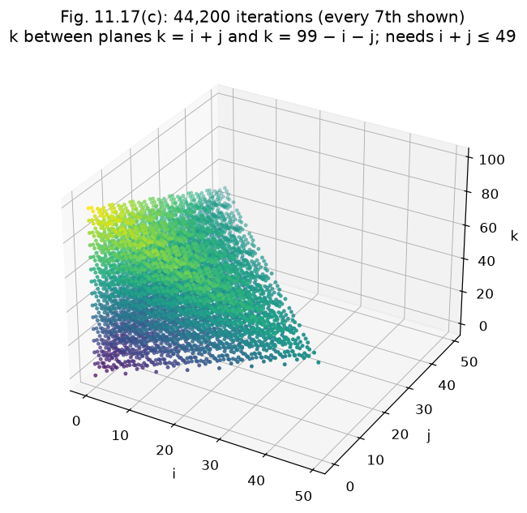
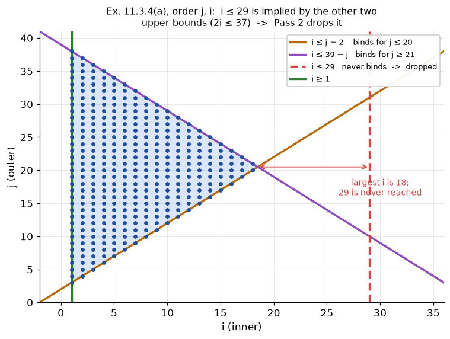
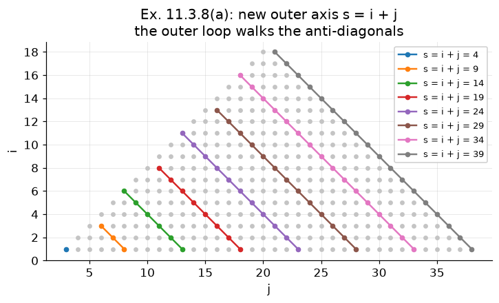

# §11.3.7 Exercises for Section 11.3

Part of [11.3 Iteration Spaces](../README.md) · previous: [§11.3.6](11.3.6_changing_axes.md) · next: [Beyond §11.3](beyond_11.3.md)

All loop nests below were generated by the numbered programs in `code/src/` (one per exercise, e.g. `./run.sh 10` for Exercise 11.3.4) and verified to visit **exactly** the same integer points as a brute-force sweep of the original nest: 342 points for Fig. 11.17(a), 9 910 for (b), 44 200 for (c). Each program also re-checks the hand-written answer below as plain C++ loops.

(Exercise 11.3.4 is presented *after* 11.3.5 and 11.3.6, because reversing the nesting order is exactly the elimination those two exercises ask for.)

The three loop nests of Fig. 11.17:

```c
/* (a) */ for (i = 1; i < 30; i++)   for (j = i+2; j < 40-i; j++)                              X[i][j] = 0;
/* (b) */ for (i = 10; i <= 1000; i++) for (j = i; j < i+10; j++)                             X[i][j] = 0;
/* (c) */ for (i = 0; i < 100; i++)  for (j = 0; j < 100+i; j++) for (k = i+j; k < 100-i-j; k++) X[i][j][k] = 0;
```

## Exercise 11.3.1 — unit-stride rewrites

Substitute `i = c·j + a` (`c` = old stride, `a` = old start) and round the upper limit *down*.

| | original | rewritten | why |
|---|---|---|---|
| (a) | `for (i=10; i<50; i+=7) X[i][i+1]=0;` | `for (j=0; j<=5; j++) X[7*j+10][7*j+11]=0;` | `7j+10 ≤ 49 ⇒ j ≤ 5.57 ⇒ j ≤ 5` |
| (b) | `for (i=-3; i<=10; i+=2) X[i]=X[i+1];` | `for (j=0; j<=6; j++) X[2*j-3]=X[2*j-2];` | `2j−3 ≤ 10 ⇒ j ≤ 6` |
| (c) | `for (i=50; i>=10; i--) X[i]=0;` | `for (j=0; j<=40; j++) X[50-j]=0;` | descending = stride −1: `i = 50 − j`, `50−j ≥ 10 ⇒ j ≤ 40` |

### Code example 07 — `./run.sh 7`

Program 07 (`code/src/07_exercise_11_3_1_unit_stride.cpp`) runs each original loop and its rewrite and compares the sequences of `i`:

**code/src/07_exercise_11_3_1_unit_stride.cpp**
```cpp
#include <cstdio>
#include <vector>

int main() {
  std::printf("Exercise 11.3.1 (unit-stride rewrites)\n");
  std::vector<long> a, b;
  for (long i = 10; i < 50; i += 7)
    a.push_back(i); // (a)
  for (long j = 0; j <= 5; j++)
    b.push_back(7 * j + 10); // i = 7j+10, 7j+10 <= 49 -> j <= 5
  std::printf("  (a) i=10..49 step 7  vs  j=0..5, i=7j+10     %s\n",
              a == b ? "same" : "MISMATCH");
  a.clear();
  b.clear();
  for (long i = -3; i <= 10; i += 2)
    a.push_back(i); // (b)
  for (long j = 0; j <= 6; j++)
    b.push_back(2 * j - 3); // i = 2j-3, 2j-3 <= 10 -> j <= 6
  std::printf("  (b) i=-3..10 step 2  vs  j=0..6, i=2j-3      %s\n",
              a == b ? "same" : "MISMATCH");
  a.clear();
  b.clear();
  for (long i = 50; i >= 10; i--)
    a.push_back(i); // (c) descending
  for (long j = 0; j <= 40; j++)
    b.push_back(50 - j); // i = 50-j, 50-j >= 10 -> j <= 40
  std::printf("  (c) i=50 down to 10  vs  j=0..40, i=50-j     %s\n",
              a == b ? "same" : "MISMATCH");
}
```

**./run.sh 7**
```
Exercise 11.3.1 (unit-stride rewrites)
  (a) i=10..49 step 7  vs  j=0..5, i=7j+10     same
  (b) i=-3..10 step 2  vs  j=0..6, i=2j-3      same
  (c) i=50 down to 10  vs  j=0..40, i=50-j     same
```

## Exercise 11.3.2 — describe the iteration spaces

**(a)** A triangle. `j` starts two above `i` (line `j = i + 2`) and must stay below `j = 39 − i`, which *falls* as `i` grows. The two lines cross at `i = 18.5`, so for `i ≥ 19` the inner loop is empty — the written bound `i < 30` is never reached. Vertices (as integer points): `(1,3)`, `(1,38)`, `(18,20)`/`(18,21)`. 342 iterations.



**(b)** A diagonal band of width 10: for each `i` from 10 to 1000, `j` runs over `i, i+1, …, i+9`. 991 × 10 = 9 910 iterations.



**(c)** A 3-D solid. `k` lies between the planes `k = i + j` and `k = 99 − i − j`, which only leaves room when `i + j ≤ 49`. So although `i` is declared to run to 99 and `j` to `99 + i`, only `0 ≤ i`, `0 ≤ j`, `i + j ≤ 49` contribute. 44 200 iterations.



```
   ASCII slice of (c) at i = 0:            j
                                       49 │■                    for each (i,j) the k-range is
                                          │■■                   [i+j, 99−i−j], length 100 − 2(i+j),
                                          │■■■                  which shrinks to 2 at i+j = 49
                                          │ ...
                                        0 └──────────────► k
                                          0            99
```

### Code example 08 — `./run.sh 8`

Program 08 (`code/src/08_exercise_11_3_2_iteration_spaces.cpp`) counts the three point sets twice, by running the original nests and by enumerating the integer points of the three nests' bound inequalities, and checks that the counts agree. The figures above were rendered from these point sets.

**code/src/08_exercise_11_3_2_iteration_spaces.cpp**
```cpp
#include "enumerate.h"

int main() {
  // The three loop nests of Fig. 11.17 as polyhedra ('<' bounds written as
  // '<=' by subtracting 1).
  Polyhedron nestA; // (a) for (i=1;i<30;i++) for (j=i+2;j<40-i;j++)
  nestA.vars = {"i", "j"};
  nestA.addInequality({{"i", 1}}, -1)
      .addInequality({{"i", -1}}, 29)             //  1 <= i <= 29
      .addInequality({{"j", 1}, {"i", -1}}, -2)   // j >= i + 2
      .addInequality({{"j", -1}, {"i", -1}}, 39); // j <= 39 - i
  Polyhedron nestB; // (b) for (i=10;i<=1000;i++) for (j=i;j<i+10;j++)
  nestB.vars = {"i", "j"};
  nestB.addInequality({{"i", 1}}, -10)
      .addInequality({{"i", -1}}, 1000)         // 10 <= i <= 1000
      .addInequality({{"j", 1}, {"i", -1}}, 0)  //  j - i >= 0      j >= i
      .addInequality({{"j", -1}, {"i", 1}}, 9); // -j + i + 9 >= 0  j <= i + 9
  Polyhedron nestC; // (c) for (i=0;i<100;i++) for (j=0;j<100+i;j++)
                    //     for (k=i+j;k<100-i-j;k++)
  nestC.vars = {"i", "j", "k"};
  nestC.addInequality({{"i", 1}}, 0)
      .addInequality({{"i", -1}}, 99) // 0 <= i <= 99
      .addInequality({{"j", 1}}, 0)
      .addInequality({{"j", -1}, {"i", 1}}, 99)              // 0 <= j <= 99 + i
      .addInequality({{"k", 1}, {"i", -1}, {"j", -1}}, 0)    // k >= i + j
      .addInequality({{"k", -1}, {"i", -1}, {"j", -1}}, 99); // k <= 99 - i - j

  long la = 0, lb = 0, lc = 0; // count by running the original nests
  for (long i = 1; i < 30; i++)
    for (long j = i + 2; j < 40 - i; j++)
      la++;
  for (long i = 10; i <= 1000; i++)
    for (long j = i; j < i + 10; j++)
      lb++;
  for (long i = 0; i < 100; i++)
    for (long j = 0; j < 100 + i; j++)
      for (long k = i + j; k < 100 - i - j; k++)
        lc++;
  size_t pa = enumerateBox(nestA, -5, 60).size();
  size_t pb = enumerateBox(nestB, 0, 1020).size();
  size_t pc = enumerateBox(nestC, -5, 210).size();
  std::cout << "Fig. 11.17(a): for i=1..29 / for j=i+2..39-i          " << la
            << " iterations (i actually only reaches 18)\n";
  std::cout << "Fig. 11.17(b): for i=10..1000 / for j=i..i+9           " << lb
            << " iterations\n";
  std::cout << "Fig. 11.17(c): for i / for j / for k=i+j..99-i-j       " << lc
            << " iterations (i,j really only reach 49)\n";
  std::cout << "polyhedron point counts (brute force): (a) " << pa << "  (b) "
            << pb << "  (c) " << pc << "   "
            << (((long)pa == la && (long)pb == lb && (long)pc == lc)
                    ? "== loop nests"
                    : "MISMATCH")
            << "\n";
}
```

**./run.sh 8**
```
Fig. 11.17(a): for i=1..29 / for j=i+2..39-i          342 iterations (i actually only reaches 18)
Fig. 11.17(b): for i=10..1000 / for j=i..i+9           9910 iterations
Fig. 11.17(c): for i / for j / for k=i+j..99-i-j       44200 iterations (i,j really only reach 49)
polyhedron point counts (brute force): (a) 342  (b) 9910  (c) 44200   == loop nests
```

## Exercise 11.3.3 — the `B`, `b` form

Vector of unknowns `(i, j)` for (a),(b) and `(i, j, k)` for (c). Each source bound gives one row. The loops use `<`, and the matrix form needs `≤`, so subtract 1 from the right-hand side first (legal only because the indices are integers): `i < 30` becomes `i ≤ 29`, `j < 40 − i` becomes `j ≤ 39 − i`, `k < 100 − i − j` becomes `k ≤ 99 − i − j`. Then apply the two rewriting moves of §11.3.3 to each inequality: `j ≤ 39 − i` → `−i − j + 39 ≥ 0`, which is the row `[−1 −1]` with constant `39`.

```
 (a)  i ≥ 1          [ 1  0]   [ -1]      (b)  i ≥ 10        [ 1  0]   [ -10]
      i ≤ 29         [-1  0]   [ 29]           i ≤ 1000      [-1  0]   [1000]
      j ≥ i+2    B = [-1  1] b=[ -2]           j ≥ i     B = [-1  1] b=[   0]
      j ≤ 39−i       [-1 -1]   [ 39]           j ≤ i+9       [ 1 -1]   [   9]

 (c)  i ≥ 0            [ 1  0  0]   [ 0]
      i ≤ 99           [-1  0  0]   [99]
      j ≥ 0            [ 0  1  0]   [ 0]
      j ≤ 99+i     B = [ 1 -1  0] b=[99]
      k ≥ i+j          [-1 -1  1]   [ 0]
      k ≤ 99−i−j       [-1 -1 -1]   [99]
```

### Code example 09 — `./run.sh 9`

Program 09 (`code/src/09_exercise_11_3_3_matrix_form.cpp`) builds the three polyhedra with `addInequality` and prints the same rows, one per line in the `a·x + c >= 0` form:

**code/src/09_exercise_11_3_3_matrix_form.cpp**
```cpp
#include "poly.h"

int main() {
  // The three loop nests of Fig. 11.17 as polyhedra ('<' bounds written as
  // '<=' by subtracting 1).
  Polyhedron nestA; // (a) for (i=1;i<30;i++) for (j=i+2;j<40-i;j++)
  nestA.vars = {"i", "j"};
  nestA.addInequality({{"i", 1}}, -1)
      .addInequality({{"i", -1}}, 29)             //  1 <= i <= 29
      .addInequality({{"j", 1}, {"i", -1}}, -2)   // j >= i + 2
      .addInequality({{"j", -1}, {"i", -1}}, 39); // j <= 39 - i
  Polyhedron nestB; // (b) for (i=10;i<=1000;i++) for (j=i;j<i+10;j++)
  nestB.vars = {"i", "j"};
  nestB.addInequality({{"i", 1}}, -10)
      .addInequality({{"i", -1}}, 1000)         // 10 <= i <= 1000
      .addInequality({{"j", 1}, {"i", -1}}, 0)  //  j - i >= 0      j >= i
      .addInequality({{"j", -1}, {"i", 1}}, 9); // -j + i + 9 >= 0  j <= i + 9
  Polyhedron nestC; // (c) for (i=0;i<100;i++) for (j=0;j<100+i;j++)
                    //     for (k=i+j;k<100-i-j;k++)
  nestC.vars = {"i", "j", "k"};
  nestC.addInequality({{"i", 1}}, 0)
      .addInequality({{"i", -1}}, 99) // 0 <= i <= 99
      .addInequality({{"j", 1}}, 0)
      .addInequality({{"j", -1}, {"i", 1}}, 99)              // 0 <= j <= 99 + i
      .addInequality({{"k", 1}, {"i", -1}, {"j", -1}}, 0)    // k >= i + j
      .addInequality({{"k", -1}, {"i", -1}, {"j", -1}}, 99); // k <= 99 - i - j
  std::cout << "Exercise 11.3.3: rows of B x + b >= 0 ('<' bounds written as "
               "'<=' by subtracting 1)\n";
  printRows(nestA, "(a)");
  printRows(nestB, "(b)");
  printRows(nestC, "(c)");
}
```

**./run.sh 9**
```
Exercise 11.3.3: rows of B x + b >= 0 ('<' bounds written as '<=' by subtracting 1)
(a)  (vars: i j )
    i - 1 >= 0
    -i + 29 >= 0
    -i + j - 2 >= 0
    -i - j + 39 >= 0
(b)  (vars: i j )
    i - 10 >= 0
    -i + 1000 >= 0
    -i + j >= 0
    i - j + 9 >= 0
(c)  (vars: i j k )
    i >= 0
    -i + 99 >= 0
    j >= 0
    i - j + 99 >= 0
    -i - j + k >= 0
    -i - j - k + 99 >= 0
```

## Exercise 11.3.5 — eliminate `i`

Each block below is one run of Algorithm 11.11 by hand: list the lower and upper bounds on the variable, form every (lower, upper) pair as `lower ≤ upper`, simplify, and keep the rows that did not mention the variable. The result is the shadow of the iteration space on the remaining axes.

```
 (a)  lower: i ≥ 1.   upper: i ≤ 29,  i ≤ j−2,  i ≤ 39−j.     1 × 3 = 3 pairs
      (1 ≤ 29)  trivial        (1 ≤ j−2) → j ≥ 3        (1 ≤ 39−j) → j ≤ 38
      result:  3 ≤ j ≤ 38

 (b)  lower: i ≥ 10, i ≥ j−9.   upper: i ≤ 1000, i ≤ j.      2 × 2 = 4 pairs
      (10 ≤ 1000) trivial   (10 ≤ j) → j ≥ 10   (j−9 ≤ 1000) → j ≤ 1009   (j−9 ≤ j) trivial
      result:  10 ≤ j ≤ 1009

 (c)  lower: i ≥ 0, i ≥ j−99.   upper: i ≤ 99, i ≤ k−j, i ≤ 99−j−k.     2 × 3 = 6 pairs
      (0 ≤ 99) trivial      (0 ≤ k−j) → k ≥ j            (0 ≤ 99−j−k) → j+k ≤ 99
      (j−99 ≤ 99) → j ≤ 198 (j−99 ≤ k−j) → 2j ≤ k+99     (j−99 ≤ 99−j−k) → 2j+k ≤ 198
      result:  j ≥ 0 (unchanged row),  k ≥ j,  j+k ≤ 99,  j ≤ 198,  2j ≤ k+99,  2j+k ≤ 198
      (the last three are implied by the first three — FM happily produces redundancies)
```

**Part (b) in detail**, a case with two lower and two upper bounds. The nest is `for (i = 10; i <= 1000; i++) for (j = i; j < i+10; j++)`, so the conditions are `10 ≤ i ≤ 1000` and `i ≤ j ≤ i + 9`, and the input rows are

| condition | row | as a bound on `i` |
|---|---|---|
| `i ≥ 10` | `i − 10 ≥ 0` | lower: `10 ≤ i` |
| `i ≤ 1000` | `−i + 1000 ≥ 0` | upper: `i ≤ 1000` |
| `j ≥ i` | `−i + j ≥ 0` | upper: `i ≤ j` |
| `j ≤ i + 9` | `i − j + 9 ≥ 0` | lower: `j − 9 ≤ i` |

All four mention `i`, so all four are consumed and nothing passes through. Two lower bounds times two upper bounds gives four pairs:

| pair | new row | fate |
|---|---|---|
| `i − 10 ≥ 0` with `−i + 1000 ≥ 0` | `990 ≥ 0` | no variable left, and true: adds no row |
| `i − 10 ≥ 0` with `−i + j ≥ 0` | `j − 10 ≥ 0` | kept |
| `i − j + 9 ≥ 0` with `−i + 1000 ≥ 0` | `−j + 1009 ≥ 0` | kept |
| `i − j + 9 ≥ 0` with `−i + j ≥ 0` | `9 ≥ 0` | no variable left, and true: adds no row |

So `S'` is `10 ≤ j ≤ 1009`, again with no `i` anywhere.

Be careful with what "true" refers to in the first pair. It is a statement about the *new* row `990 ≥ 0`, not about the two input rows. The input rows certainly restrict `i`: `i = 1100` violates `−i + 1000 ≥ 0`, so no point `(1100, j)` is in `S` for any `j`. But that restriction is exactly what the elimination gives up, because `S'` no longer speaks about particular values of `i` at all. The only question a pair answers is "can its lower bound and its upper bound both be met by *some* `i`?", and for this pair that question is `10 ≤ 1000`. The answer is yes no matter what `j` is, so the pair puts no condition on `j` and contributes nothing to `S'`. (`i = 1100` is not forgotten either: it was never in `S`, and nothing in `S'` claims it was. `S'` only says that for every `j` in `10..1009` *some* `i` works, for instance `i = 10` when `j = 10`.) The pairs that do restrict `j` are the two where `j` sits on one side: `10 ≤ j` and `j − 9 ≤ 1000`.

**A non-unit coefficient in part (c).** The pair `i − j + 99 ≥ 0` with `−i − j + k ≥ 0` adds to `−2j + k + 99 ≥ 0`. The `i` terms cancel as always, but `j` now carries the coefficient 2: the new row is a genuine inequality between the remaining variables, not a copy of an old one.

### Code example 11 — `./run.sh 11`

Program 11 (`code/src/11_exercise_11_3_5_eliminate_i.cpp`) runs the same elimination with tracing on, so every pair above appears as one printed line:

**code/src/11_exercise_11_3_5_eliminate_i.cpp**
```cpp
#include "fourier_motzkin.h"

int main() {
  // The three loop nests of Fig. 11.17 as polyhedra ('<' bounds written as
  // '<=' by subtracting 1).
  Polyhedron nestA; // (a) for (i=1;i<30;i++) for (j=i+2;j<40-i;j++)
  nestA.vars = {"i", "j"};
  nestA.addInequality({{"i", 1}}, -1)
      .addInequality({{"i", -1}}, 29)             //  1 <= i <= 29
      .addInequality({{"j", 1}, {"i", -1}}, -2)   // j >= i + 2
      .addInequality({{"j", -1}, {"i", -1}}, 39); // j <= 39 - i
  Polyhedron nestB; // (b) for (i=10;i<=1000;i++) for (j=i;j<i+10;j++)
  nestB.vars = {"i", "j"};
  nestB.addInequality({{"i", 1}}, -10)
      .addInequality({{"i", -1}}, 1000)         // 10 <= i <= 1000
      .addInequality({{"j", 1}, {"i", -1}}, 0)  //  j - i >= 0      j >= i
      .addInequality({{"j", -1}, {"i", 1}}, 9); // -j + i + 9 >= 0  j <= i + 9
  Polyhedron nestC; // (c) for (i=0;i<100;i++) for (j=0;j<100+i;j++)
                    //     for (k=i+j;k<100-i-j;k++)
  nestC.vars = {"i", "j", "k"};
  nestC.addInequality({{"i", 1}}, 0)
      .addInequality({{"i", -1}}, 99) // 0 <= i <= 99
      .addInequality({{"j", 1}}, 0)
      .addInequality({{"j", -1}, {"i", 1}}, 99)              // 0 <= j <= 99 + i
      .addInequality({{"k", 1}, {"i", -1}, {"j", -1}}, 0)    // k >= i + j
      .addInequality({{"k", -1}, {"i", -1}, {"j", -1}}, 99); // k <= 99 - i - j
  std::cout << "Exercise 11.3.5: eliminate i\n";
  printRows(eliminate(nestA, nestA.column("i"), true), "(a) result");
  printRows(eliminate(nestB, nestB.column("i"), true), "(b) result");
  printRows(eliminate(nestC, nestC.column("i"), true), "(c) result");
}
```

**./run.sh 11**
```
Exercise 11.3.5: eliminate i
  eliminating i: 1 lower bound(s), 3 upper bound(s) -> at most 3 new rows
    (i - 1 >= 0)  x  (-i + 29 >= 0)  =>  28 >= 0   [always true, dropped]
    (i - 1 >= 0)  x  (-i + j - 2 >= 0)  =>  j - 3 >= 0
    (i - 1 >= 0)  x  (-i - j + 39 >= 0)  =>  -j + 38 >= 0
(a) result  (vars: i j )
    j - 3 >= 0
    -j + 38 >= 0
  eliminating i: 2 lower bound(s), 2 upper bound(s) -> at most 4 new rows
    (i - 10 >= 0)  x  (-i + 1000 >= 0)  =>  990 >= 0   [always true, dropped]
    (i - 10 >= 0)  x  (-i + j >= 0)  =>  j - 10 >= 0
    (i - j + 9 >= 0)  x  (-i + 1000 >= 0)  =>  -j + 1009 >= 0
    (i - j + 9 >= 0)  x  (-i + j >= 0)  =>  9 >= 0   [always true, dropped]
(b) result  (vars: i j )
    j - 10 >= 0
    -j + 1009 >= 0
  eliminating i: 2 lower bound(s), 3 upper bound(s) -> at most 6 new rows
    (i >= 0)  x  (-i + 99 >= 0)  =>  99 >= 0   [always true, dropped]
    (i >= 0)  x  (-i - j + k >= 0)  =>  -j + k >= 0
    (i >= 0)  x  (-i - j - k + 99 >= 0)  =>  -j - k + 99 >= 0
    (i - j + 99 >= 0)  x  (-i + 99 >= 0)  =>  -j + 198 >= 0
    (i - j + 99 >= 0)  x  (-i - j + k >= 0)  =>  -2*j + k + 99 >= 0
    (i - j + 99 >= 0)  x  (-i - j - k + 99 >= 0)  =>  -2*j - k + 198 >= 0
(c) result  (vars: i j k )
    j >= 0
    -j + k >= 0
    -j - k + 99 >= 0
    -j + 198 >= 0
    -2*j + k + 99 >= 0
    -2*j - k + 198 >= 0
```

## Exercise 11.3.6 — eliminate `j`

```
 (a)  lower: j ≥ i+2.   upper: j ≤ 39−i.         1 pair:  i+2 ≤ 39−i  → 2i ≤ 37 → i ≤ 18
      result:  1 ≤ i ≤ 29  and  i ≤ 18   (so really 1 ≤ i ≤ 18 — confirms 11.3.2(a))
 (b)  lower: j ≥ i.   upper: j ≤ i+9.            1 pair:  i ≤ i+9 → 9 ≥ 0, trivial
      result:  10 ≤ i ≤ 1000   (every i has a non-empty j range — the band is full)
 (c)  lower: j ≥ 0.   upper: j ≤ 99+i, j ≤ k−i, j ≤ 99−i−k.     3 pairs
      (0 ≤ 99+i) → i ≥ −99 (redundant)   (0 ≤ k−i) → k ≥ i   (0 ≤ 99−i−k) → i+k ≤ 99
      result:  0 ≤ i ≤ 99,  i ≥ −99,  k ≥ i,  i+k ≤ 99
```

### Code example 12 — `./run.sh 12`

Program 12 (`code/src/12_exercise_11_3_6_eliminate_j.cpp`), likewise:

**code/src/12_exercise_11_3_6_eliminate_j.cpp**
```cpp
#include "fourier_motzkin.h"

int main() {
  // The three loop nests of Fig. 11.17 as polyhedra ('<' bounds written as
  // '<=' by subtracting 1).
  Polyhedron nestA; // (a) for (i=1;i<30;i++) for (j=i+2;j<40-i;j++)
  nestA.vars = {"i", "j"};
  nestA.addInequality({{"i", 1}}, -1)
      .addInequality({{"i", -1}}, 29)             //  1 <= i <= 29
      .addInequality({{"j", 1}, {"i", -1}}, -2)   // j >= i + 2
      .addInequality({{"j", -1}, {"i", -1}}, 39); // j <= 39 - i
  Polyhedron nestB; // (b) for (i=10;i<=1000;i++) for (j=i;j<i+10;j++)
  nestB.vars = {"i", "j"};
  nestB.addInequality({{"i", 1}}, -10)
      .addInequality({{"i", -1}}, 1000)         // 10 <= i <= 1000
      .addInequality({{"j", 1}, {"i", -1}}, 0)  //  j - i >= 0      j >= i
      .addInequality({{"j", -1}, {"i", 1}}, 9); // -j + i + 9 >= 0  j <= i + 9
  Polyhedron nestC; // (c) for (i=0;i<100;i++) for (j=0;j<100+i;j++)
                    //     for (k=i+j;k<100-i-j;k++)
  nestC.vars = {"i", "j", "k"};
  nestC.addInequality({{"i", 1}}, 0)
      .addInequality({{"i", -1}}, 99) // 0 <= i <= 99
      .addInequality({{"j", 1}}, 0)
      .addInequality({{"j", -1}, {"i", 1}}, 99)              // 0 <= j <= 99 + i
      .addInequality({{"k", 1}, {"i", -1}, {"j", -1}}, 0)    // k >= i + j
      .addInequality({{"k", -1}, {"i", -1}, {"j", -1}}, 99); // k <= 99 - i - j
  std::cout << "Exercise 11.3.6: eliminate j\n";
  printRows(eliminate(nestA, nestA.column("j"), true), "(a) result");
  printRows(eliminate(nestB, nestB.column("j"), true), "(b) result");
  printRows(eliminate(nestC, nestC.column("j"), true), "(c) result");
}
```

**./run.sh 12**
```
Exercise 11.3.6: eliminate j
  eliminating j: 1 lower bound(s), 1 upper bound(s) -> at most 1 new rows
    (-i + j - 2 >= 0)  x  (-i - j + 39 >= 0)  =>  -i + 18 >= 0
(a) result  (vars: i j )
    i - 1 >= 0
    -i + 29 >= 0
    -i + 18 >= 0
  eliminating j: 1 lower bound(s), 1 upper bound(s) -> at most 1 new rows
    (-i + j >= 0)  x  (i - j + 9 >= 0)  =>  9 >= 0   [always true, dropped]
(b) result  (vars: i j )
    i - 10 >= 0
    -i + 1000 >= 0
  eliminating j: 1 lower bound(s), 3 upper bound(s) -> at most 3 new rows
    (j >= 0)  x  (i - j + 99 >= 0)  =>  i + 99 >= 0
    (j >= 0)  x  (-i - j + k >= 0)  =>  -i + k >= 0
    (j >= 0)  x  (-i - j - k + 99 >= 0)  =>  -i - k + 99 >= 0
(c) result  (vars: i j k )
    i >= 0
    -i + 99 >= 0
    i + 99 >= 0
    -i + k >= 0
    -i - k + 99 >= 0
```

## Exercise 11.3.4 — reverse the nesting order

Run Algorithm 11.13 with order `(j, i)` for (a),(b) and `(k, j, i)` for (c). Redundant bounds have been pruned (e.g. in (a) the bound `i ≤ 29` is dropped because `i ≤ j−2` and `i ≤ 39−j` already force `i ≤ 18`). With the book's weaker pruning rule (see *Where the tool goes beyond Fig. 11.15* in [§11.3.5](11.3.5_controlling_execution_order.md)) the inner bound of (a) would read `min(29, j − 2, 39 − j)`; both are correct.

```c
/* (a) */ for (j = 3; j <= 38; j++)
              for (i = 1; i <= min(j - 2, 39 - j); i++)
                  X[i][j] = 0;

/* (b) */ for (j = 10; j <= 1009; j++)
              for (i = max(10, j - 9); i <= min(1000, j); i++)
                  X[i][j] = 0;

/* (c) */ for (k = 0; k <= 99; k++)
              for (j = 0; j <= min(k, 99 - k); j++)
                  for (i = 0; i <= min(k - j, 99 - k - j); i++)
                      X[i][j][k] = 0;
```

**Why `i ≤ 29` goes in (a).** Pass 2 of Algorithm 11.13 (see *Pass 2: the question the pruning pass asks* in [§11.3.5](11.3.5_controlling_execution_order.md)) asks, for every candidate bound, whether there is any value of the outer variables for which it is the binding one. In the order `j`, `i` the outer loop keeps `3 ≤ j ≤ 38`, so `S' = {3 ≤ j ≤ 38}`. The inner loop's candidates are `i ≥ 1` and the three upper bounds `i ≤ 29`, `i ≤ j − 2`, `i ≤ 39 − j`. Try a few `j`:

| `j` | `j − 2` | `39 − j` | `min(j − 2, 39 − j)` | is `29` ever the smallest? |
|---|---|---|---|---|
| 3 | 1 | 36 | 1 | no |
| 10 | 8 | 29 | 8 | no |
| 20 | 18 | 19 | 18 | no |
| 21 | 19 | 18 | 18 | no |
| 30 | 28 | 9 | 9 | no |
| 38 | 36 | 1 | 1 | no |

The largest value `min(j − 2, 39 − j)` ever takes over `3 ≤ j ≤ 38` is 18, at `j = 20` and `j = 21`. The bound `i ≤ 29` is never the one that stops the inner loop, so it is dropped, and the generated loop reads `min(j - 2, -j + 39)` instead of `min(29, j - 2, -j + 39)`. The picture: the two kept upper-bound lines touch the shape, the line `i = 29` floats far to the right of it.



**The same test, done by `implied()`.** "Never binding" is the same as "implied by the others": whenever `3 ≤ j ≤ 38`, `i ≤ j − 2` and `i ≤ 39 − j` all hold, `i ≤ 29` holds automatically. By hand: add the two upper bounds, `2i ≤ 37`, so `i ≤ 18`, and `18 ≤ 29`. Mechanically the tool asks the opposite question: can the context hold *and* the bound fail? Over the integers "`i ≤ 29` fails" is `i ≥ 30`, so it adds that row to the context and runs Fourier–Motzkin to the end, looking for a false constant:

```
    context:  j - 3 >= 0,  -j + 38 >= 0,  i - 1 >= 0,  -i + j - 2 >= 0,  -i - j + 39 >= 0
    added:    i - 30 >= 0                                      (NOT  i <= 29)

    eliminate i:   (i - 30 >= 0) x (-i + j - 2 >= 0)   =>   j - 32 >= 0       i.e.  j >= 32
                   (i - 30 >= 0) x (-i - j + 39 >= 0)  =>   -j + 9 >= 0       i.e.  j <= 9
                   (the pairs with i - 1 >= 0 just give back 3 <= j <= 38)
    eliminate j:   (j - 32 >= 0)  x (-j + 9 >= 0)      =>   -23 >= 0          FALSE
```

No `j` can be both `≥ 32` and `≤ 9`: the context cannot hold while `i ≤ 29` fails, so `i ≤ 29` is implied and goes. The book's Fig. 11.15 would keep it, because it tests a bound against `S'` alone; the tool also puts the other bounds of the same loop into the context (see *Where the tool goes beyond Fig. 11.15* in [§11.3.5](11.3.5_controlling_execution_order.md)).

Trace for (c) (abridged from the output of `./run.sh 10`): eliminating `i` gives 6 rows, eliminating `j` gives 4 rows on `k` alone, eliminating `k` leaves only trivially-true constants (so the space is non-empty); the pruning pass then removes 7 redundant bounds.

```
 (c) order k, j, i:
   S₂ = FM(S, i) : j ≥ 0, k ≥ j, j+k ≤ 99, j ≤ 198, 2j ≤ k+99, 2j+k ≤ 198
   S₁ = FM(S₂, j): k ≥ 0, k ≤ 99, k ≥ −99, k ≤ 198
   S₀ = FM(S₁, k): {}   (all constants ≥ 0 → non-empty)
   pruning drops: k ≥ −99, k ≤ 198, j ≤ 198, 2j ≤ k+99, 2j+k ≤ 198, i ≥ j−99, i ≤ 99
```

### Code example 10 — `./run.sh 10`

Program 10 (`code/src/10_exercise_11_3_4_reverse_order.cpp`) generates all of the above, runs (a) and (c) in their original order too, verifies each nest against brute force, and re-checks the three hand-written answers as plain C++. The full output is 125 lines; here are the generated loops and the verdicts (`...` marks omitted trace lines):

As in program 05, each nest goes through `reorder()`, the pure-reorder form of `experiment()`.

**code/src/10_exercise_11_3_4_reverse_order.cpp**
```cpp
#include "experiment.h"

int main() {
  // The three loop nests of Fig. 11.17 as polyhedra ('<' bounds written as
  // '<=' by subtracting 1).
  Polyhedron nestA; // (a) for (i=1;i<30;i++) for (j=i+2;j<40-i;j++)
  nestA.vars = {"i", "j"};
  nestA.addInequality({{"i", 1}}, -1)
      .addInequality({{"i", -1}}, 29)             //  1 <= i <= 29
      .addInequality({{"j", 1}, {"i", -1}}, -2)   // j >= i + 2
      .addInequality({{"j", -1}, {"i", -1}}, 39); // j <= 39 - i
  Polyhedron nestB; // (b) for (i=10;i<=1000;i++) for (j=i;j<i+10;j++)
  nestB.vars = {"i", "j"};
  nestB.addInequality({{"i", 1}}, -10)
      .addInequality({{"i", -1}}, 1000)         // 10 <= i <= 1000
      .addInequality({{"j", 1}, {"i", -1}}, 0)  //  j - i >= 0      j >= i
      .addInequality({{"j", -1}, {"i", 1}}, 9); // -j + i + 9 >= 0  j <= i + 9
  Polyhedron nestC; // (c) for (i=0;i<100;i++) for (j=0;j<100+i;j++)
                    //     for (k=i+j;k<100-i-j;k++)
  nestC.vars = {"i", "j", "k"};
  nestC.addInequality({{"i", 1}}, 0)
      .addInequality({{"i", -1}}, 99) // 0 <= i <= 99
      .addInequality({{"j", 1}}, 0)
      .addInequality({{"j", -1}, {"i", 1}}, 99)              // 0 <= j <= 99 + i
      .addInequality({{"k", 1}, {"i", -1}, {"j", -1}}, 0)    // k >= i + j
      .addInequality({{"k", -1}, {"i", -1}, {"j", -1}}, 99); // k <= 99 - i - j
  // brute-force boxes that contain each polyhedron (see program 02: any
  // containing box gives the same point set)
  const int64_t loA = -5, hiA = 60, loB = 0, hiB = 1020, loC = -5, hiC = 210;
  // reorder(title, poly, loopOrder, boxLo, boxHi, body, verbose)
  reorder("(a) original order i,j", nestA, {"i", "j"}, loA, hiA, "X[i][j] = 0;",
          false);
  reorder("(a) reversed order j,i", nestA, {"j", "i"}, loA, hiA, "X[i][j] = 0;",
          true);
  reorder("(b) reversed order j,i", nestB, {"j", "i"}, loB, hiB, "X[i][j] = 0;",
          false);
  reorder("(c) original order i,j,k (note the tightened bounds)", nestC,
          {"i", "j", "k"}, loC, hiC, "X[i][j][k] = 0;", false);
  reorder("(c) reversed order k,j,i", nestC, {"k", "j", "i"}, loC, hiC,
          "X[i][j][k] = 0;", true);

  // the points the original nests visit, for the plain-loop checks below
  std::set<IJ> refA, refB;
  std::set<IJK> refC;
  for (long i = 1; i < 30; i++)
    for (long j = i + 2; j < 40 - i; j++)
      refA.insert({i, j});
  for (long i = 10; i <= 1000; i++)
    for (long j = i; j < i + 10; j++)
      refB.insert({i, j});
  for (long i = 0; i < 100; i++)
    for (long j = 0; j < 100 + i; j++)
      for (long k = i + j; k < 100 - i - j; k++)
        refC.insert({i, j, k});
  std::cout << "\nplain-loop checks of the answers:\n";
  // Each block below runs one hand-written answer as a plain loop, collects
  // the points it visits and how often it iterated, and compares with the
  // original nest (report prints one line per answer).
  {
    std::set<IJ> s;
    long n = 0;
    for (long j = 3; j <= 38; j++)
      for (long i = 1; i <= std::min(j - 2, 39 - j); i++) {
        s.insert({i, j});
        n++;
      }
    report("(a) for j=3..38 / for i=1..min(j-2,39-j)", refA, s, n);
  }
  {
    std::set<IJ> s;
    long n = 0;
    for (long j = 10; j <= 1009; j++)
      for (long i = std::max(10L, j - 9); i <= std::min(1000L, j); i++) {
        s.insert({i, j});
        n++;
      }
    report("(b) for j=10..1009 / for i=max(10,j-9)..min(1000,j)", refB, s, n);
  }
  {
    std::set<IJK> s;
    long n = 0;
    for (long k = 0; k <= 99; k++)
      for (long j = 0; j <= std::min(k, 99 - k); j++)
        for (long i = 0; i <= std::min(k - j, 99 - k - j); i++) {
          s.insert({i, j, k});
          n++;
        }
    report("(c) for k / for j / for i", refC, s, n);
  }
}
```

**./run.sh 10 (abridged)**
```
==== (a) original order i,j ====
for (i = 1; i <= 18; i++)
  for (j = i + 2; j <= -i + 39; j++)
    X[i][j] = 0;
  verify (a) original order i,j: 342 iterations, IDENTICAL point set to brute force (no duplicates)
  ...
==== (a) reversed order j,i ====
for (j = 3; j <= 38; j++)
  for (i = 1; i <= min(j - 2, -j + 39); i++)
    X[i][j] = 0;
  verify (a) reversed order j,i: 342 iterations, IDENTICAL point set to brute force (no duplicates)
  ...
==== (b) reversed order j,i ====
for (j = 10; j <= 1009; j++)
  for (i = max(10, j - 9); i <= min(1000, j); i++)
    X[i][j] = 0;
  verify (b) reversed order j,i: 9910 iterations, IDENTICAL point set to brute force (no duplicates)
  ...
==== (c) original order i,j,k (note the tightened bounds) ====
for (i = 0; i <= 49; i++)
  for (j = 0; j <= -i + 49; j++)
    for (k = i + j; k <= -i - j + 99; k++)
      X[i][j][k] = 0;
  verify (c) original order i,j,k (note the tightened bounds): 44200 iterations, IDENTICAL point set to brute force (no duplicates)
  ...
==== (c) reversed order k,j,i ====
for (k = 0; k <= 99; k++)
  for (j = 0; j <= min(k, -k + 99); j++)
    for (i = 0; i <= min(-j + k, -j - k + 99); i++)
      X[i][j][k] = 0;
  verify (c) reversed order k,j,i: 44200 iterations, IDENTICAL point set to brute force (no duplicates)
plain-loop checks of the answers:
  (a) for j=3..38 / for i=1..min(j-2,39-j)                342 pts  == original
  (b) for j=10..1009 / for i=max(10,j-9)..min(1000,j)    9910 pts  == original
  (c) for k / for j / for i                             44200 pts  == original
```

## Exercise 11.3.7 — new outermost axis along the main diagonal (`i = j`)

Lines parallel to `i = j` are the lines `j − i = const`. New variable `d = j − i`, outer loop `d`, inner loop `j` (as in Example 11.15); recover `i = j − d`. (The matrix `[[−1,1],[0,1]]` is unimodular.)

```c
/* (a) */ for (d = 2; d <= 37; d++)
              for (j = d + 1; j <= floor_div(d + 39, 2); j++)
                  X[j-d][j] = 0;

/* (b) */ for (d = 0; d <= 9; d++)
              for (j = d + 10; j <= d + 1000; j++)
                  X[j-d][j] = 0;

/* (c) */ for (d = -49; d <= 49; d++)
              for (j = max(d, 0); j <= floor_div(d + 49, 2); j++)
                  for (k = 2*j - d; k <= d - 2*j + 99; k++)
                      X[j-d][j][k] = 0;
```

How (a) arises: substituting `i = j − d` into the four rows gives `j − d ≥ 1`, `j − d ≤ 29`, `j ≥ (j−d) + 2 ⇒ d ≥ 2`, `j ≤ 39 − (j − d) ⇒ 2j ≤ 39 + d`. Eliminating `j` from the pairs `(j ≥ d+1) × (2j ≤ 39+d)` gives `2d + 2 ≤ 39 + d ⇒ d ≤ 37`. Note the `⌊(d+39)/2⌋`: a coefficient of 2 on `j` produces a floor.

### Code example 13 — `./run.sh 13`

Program 13 (`code/src/13_exercise_11_3_7_diagonal_axis.cpp`) substitutes `i = j − d`, runs Algorithm 11.13 with order `(d, j)` (and `(d, j, k)` for (c)), verifies, and re-checks the loops above as plain C++:

**code/src/13_exercise_11_3_7_diagonal_axis.cpp**
```cpp
#include "experiment.h"

int main() {
  // The three loop nests of Fig. 11.17 as polyhedra ('<' bounds written as
  // '<=' by subtracting 1).
  Polyhedron nestA; // (a) for (i=1;i<30;i++) for (j=i+2;j<40-i;j++)
  nestA.vars = {"i", "j"};
  nestA.addInequality({{"i", 1}}, -1)
      .addInequality({{"i", -1}}, 29)             //  1 <= i <= 29
      .addInequality({{"j", 1}, {"i", -1}}, -2)   // j >= i + 2
      .addInequality({{"j", -1}, {"i", -1}}, 39); // j <= 39 - i
  Polyhedron nestB; // (b) for (i=10;i<=1000;i++) for (j=i;j<i+10;j++)
  nestB.vars = {"i", "j"};
  nestB.addInequality({{"i", 1}}, -10)
      .addInequality({{"i", -1}}, 1000)         // 10 <= i <= 1000
      .addInequality({{"j", 1}, {"i", -1}}, 0)  //  j - i >= 0      j >= i
      .addInequality({{"j", -1}, {"i", 1}}, 9); // -j + i + 9 >= 0  j <= i + 9
  Polyhedron nestC; // (c) for (i=0;i<100;i++) for (j=0;j<100+i;j++)
                    //     for (k=i+j;k<100-i-j;k++)
  nestC.vars = {"i", "j", "k"};
  nestC.addInequality({{"i", 1}}, 0)
      .addInequality({{"i", -1}}, 99) // 0 <= i <= 99
      .addInequality({{"j", 1}}, 0)
      .addInequality({{"j", -1}, {"i", 1}}, 99)              // 0 <= j <= 99 + i
      .addInequality({{"k", 1}, {"i", -1}, {"j", -1}}, 0)    // k >= i + j
      .addInequality({{"k", -1}, {"i", -1}, {"j", -1}}, 99); // k <= 99 - i - j
  // brute-force boxes that contain each polyhedron (see program 02: any
  // containing box gives the same point set)
  const int64_t loA = -5, hiA = 60, loB = 0, hiB = 1020, loC = -5, hiC = 210;
  // (i, j[, k]) from (d, j[, k]):  i = j - d
  const Matrix transform2{{-1, 1}, {0, 1}},
      transform3{{-1, 1, 0}, {0, 1, 0}, {0, 0, 1}};
  const std::vector<int64_t> zero2{0, 0}, zero3{0, 0, 0};
  // experiment(title, poly, newVars, transform, offset, loopOrder, boxLo,
  // boxHi,
  //            body, verbose): newVars == poly.vars means a pure reorder
  experiment("(a) d = j - i", nestA, {"d", "j"}, transform2, zero2, {"d", "j"},
             loA, hiA, "X[j-d][j] = 0;", false);
  experiment("(b) d = j - i", nestB, {"d", "j"}, transform2, zero2, {"d", "j"},
             loB, hiB, "X[j-d][j] = 0;", false);
  experiment("(c) d = j - i", nestC, {"d", "j", "k"}, transform3, zero3,
             {"d", "j", "k"}, loC, hiC, "X[j-d][j][k] = 0;", false);

  // the points the original nests visit, for the plain-loop checks below
  std::set<IJ> refA, refB;
  std::set<IJK> refC;
  for (long i = 1; i < 30; i++)
    for (long j = i + 2; j < 40 - i; j++)
      refA.insert({i, j});
  for (long i = 10; i <= 1000; i++)
    for (long j = i; j < i + 10; j++)
      refB.insert({i, j});
  for (long i = 0; i < 100; i++)
    for (long j = 0; j < 100 + i; j++)
      for (long k = i + j; k < 100 - i - j; k++)
        refC.insert({i, j, k});
  std::cout << "\nplain-loop checks of the answers:\n";
  // Each block below runs one hand-written answer as a plain loop, collects
  // the points it visits and how often it iterated, and compares with the
  // original nest (report prints one line per answer).
  {
    std::set<IJ> s;
    long n = 0;
    for (long d = 2; d <= 37; d++)
      for (long j = d + 1; j <= floorDiv(d + 39, 2); j++) {
        s.insert({j - d, j});
        n++;
      }
    report("(a) for d=2..37 / for j=d+1..floor((d+39)/2)", refA, s, n);
  }
  {
    std::set<IJ> s;
    long n = 0;
    for (long d = 0; d <= 9; d++)
      for (long j = d + 10; j <= d + 1000; j++) {
        s.insert({j - d, j});
        n++;
      }
    report("(b) for d=0..9 / for j=d+10..d+1000", refB, s, n);
  }
  {
    std::set<IJK> s;
    long n = 0;
    for (long d = -49; d <= 49; d++)
      for (long j = std::max(d, 0L); j <= floorDiv(d + 49, 2); j++)
        for (long k = 2 * j - d; k <= d - 2 * j + 99; k++) {
          s.insert({j - d, j, k});
          n++;
        }
    report("(c) for d / for j / for k", refC, s, n);
  }
}
```

**./run.sh 13 (abridged)**
```
==== (a) d = j - i ====
for (d = 2; d <= 37; d++)
  for (j = d + 1; j <= floor_div(d + 39, 2); j++)
    X[j-d][j] = 0;
  verify (a) d = j - i: 342 iterations, IDENTICAL point set to brute force (no duplicates)
  ...
==== (b) d = j - i ====
for (d = 0; d <= 9; d++)
  for (j = d + 10; j <= d + 1000; j++)
    X[j-d][j] = 0;
  verify (b) d = j - i: 9910 iterations, IDENTICAL point set to brute force (no duplicates)
  ...
==== (c) d = j - i ====
for (d = -49; d <= 49; d++)
  for (j = max(d, 0); j <= floor_div(d + 49, 2); j++)
    for (k = -d + 2*j; k <= d - 2*j + 99; k++)
      X[j-d][j][k] = 0;
  verify (c) d = j - i: 44200 iterations, IDENTICAL point set to brute force (no duplicates)
plain-loop checks of the answers:
  (a) for d=2..37 / for j=d+1..floor((d+39)/2)            342 pts  == original
  (b) for d=0..9 / for j=d+10..d+1000                    9910 pts  == original
  (c) for d / for j / for k                             44200 pts  == original
```

## Exercise 11.3.8(a) — new outermost axis `s = i + j` (anti-diagonals)

Outer `s`, inner `j`, `i = s − j`.

```c
/* (a) */ for (s = 4; s <= 39; s++)
              for (j = ceil_div(s + 2, 2); j <= s - 1; j++)
                  X[s-j][j] = 0;

/* (b) */ for (s = 20; s <= 2009; s++)
              for (j = max(s - 1000, ceil_div(s, 2)); j <= min(s - 10, floor_div(s + 9, 2)); j++)
                  X[s-j][j] = 0;

/* (c) */ for (s = 0; s <= 49; s++)
              for (j = 0; j <= s; j++)
                  for (k = s; k <= 99 - s; k++)
                      X[s-j][j][k] = 0;
```



How (a) arises: substituting `i = s − j` into the four rows gives `s − j ≥ 1` (so `j ≤ s − 1`), `s − j ≤ 29` (so `j ≥ s − 29`), `j ≥ (s − j) + 2` (so `2j ≥ s + 2`, i.e. `j ≥ ⌈(s + 2)/2⌉`) and `j ≤ 39 − (s − j)` (so `s ≤ 39`, a row about `s` alone). Eliminating `j` pairs the two lower bounds with the one upper bound: `s − 29 ≤ s − 1` is always true, and `(s + 2)/2 ≤ s − 1` gives `s ≥ 4`. So `4 ≤ s ≤ 39`. In the pruning pass the lower bound `j ≥ s − 29` is dropped, because for every `s ≤ 39` it is weaker than `j ≥ ⌈(s + 2)/2⌉` (the two cross only at `s = 60`). That leaves exactly the loop above; the program's trace lists the same four substituted rows and the same bounds.

Case (c) is instructive: with `s = i + j`, both `k` bounds become `s ≤ k ≤ 99 − s`, the triangle condition `i + j ≤ 49` becomes simply `s ≤ 49`, and the whole nest becomes rectangular-ish — a hint of why choosing good axes matters in §11.7.

### Code example 14 — `./run.sh 14`

Program 14 (`code/src/14_exercise_11_3_8a_antidiagonal_axis.cpp`), same structure as program 13 with `i = s − j`:

**code/src/14_exercise_11_3_8a_antidiagonal_axis.cpp**
```cpp
#include "experiment.h"

int main() {
  // The three loop nests of Fig. 11.17 as polyhedra ('<' bounds written as
  // '<=' by subtracting 1).
  Polyhedron nestA; // (a) for (i=1;i<30;i++) for (j=i+2;j<40-i;j++)
  nestA.vars = {"i", "j"};
  nestA.addInequality({{"i", 1}}, -1)
      .addInequality({{"i", -1}}, 29)             //  1 <= i <= 29
      .addInequality({{"j", 1}, {"i", -1}}, -2)   // j >= i + 2
      .addInequality({{"j", -1}, {"i", -1}}, 39); // j <= 39 - i
  Polyhedron nestB; // (b) for (i=10;i<=1000;i++) for (j=i;j<i+10;j++)
  nestB.vars = {"i", "j"};
  nestB.addInequality({{"i", 1}}, -10)
      .addInequality({{"i", -1}}, 1000)         // 10 <= i <= 1000
      .addInequality({{"j", 1}, {"i", -1}}, 0)  //  j - i >= 0      j >= i
      .addInequality({{"j", -1}, {"i", 1}}, 9); // -j + i + 9 >= 0  j <= i + 9
  Polyhedron nestC; // (c) for (i=0;i<100;i++) for (j=0;j<100+i;j++)
                    //     for (k=i+j;k<100-i-j;k++)
  nestC.vars = {"i", "j", "k"};
  nestC.addInequality({{"i", 1}}, 0)
      .addInequality({{"i", -1}}, 99) // 0 <= i <= 99
      .addInequality({{"j", 1}}, 0)
      .addInequality({{"j", -1}, {"i", 1}}, 99)              // 0 <= j <= 99 + i
      .addInequality({{"k", 1}, {"i", -1}, {"j", -1}}, 0)    // k >= i + j
      .addInequality({{"k", -1}, {"i", -1}, {"j", -1}}, 99); // k <= 99 - i - j
  // brute-force boxes that contain each polyhedron (see program 02: any
  // containing box gives the same point set)
  const int64_t loA = -5, hiA = 60, loB = 0, hiB = 1020, loC = -5, hiC = 210;
  // (i, j[, k]) from (s, j[, k]):  i = s - j
  const Matrix transform2{{1, -1}, {0, 1}},
      transform3{{1, -1, 0}, {0, 1, 0}, {0, 0, 1}};
  const std::vector<int64_t> zero2{0, 0}, zero3{0, 0, 0};
  // experiment(title, poly, newVars, transform, offset, loopOrder, boxLo,
  // boxHi,
  //            body, verbose): newVars == poly.vars means a pure reorder
  experiment("(a) s = i + j", nestA, {"s", "j"}, transform2, zero2, {"s", "j"},
             loA, hiA, "X[s-j][j] = 0;", false);
  experiment("(b) s = i + j", nestB, {"s", "j"}, transform2, zero2, {"s", "j"},
             loB, hiB, "X[s-j][j] = 0;", false);
  experiment("(c) s = i + j", nestC, {"s", "j", "k"}, transform3, zero3,
             {"s", "j", "k"}, loC, hiC, "X[s-j][j][k] = 0;", false);

  // the points the original nests visit, for the plain-loop checks below
  std::set<IJ> refA, refB;
  std::set<IJK> refC;
  for (long i = 1; i < 30; i++)
    for (long j = i + 2; j < 40 - i; j++)
      refA.insert({i, j});
  for (long i = 10; i <= 1000; i++)
    for (long j = i; j < i + 10; j++)
      refB.insert({i, j});
  for (long i = 0; i < 100; i++)
    for (long j = 0; j < 100 + i; j++)
      for (long k = i + j; k < 100 - i - j; k++)
        refC.insert({i, j, k});
  std::cout << "\nplain-loop checks of the answers:\n";
  // Each block below runs one hand-written answer as a plain loop, collects
  // the points it visits and how often it iterated, and compares with the
  // original nest (report prints one line per answer).
  {
    std::set<IJ> s;
    long n = 0;
    for (long t = 4; t <= 39; t++)
      for (long j = ceilDiv(t + 2, 2); j <= t - 1; j++) {
        s.insert({t - j, j});
        n++;
      }
    report("(a) for s=4..39 / for j=ceil((s+2)/2)..s-1", refA, s, n);
  }
  {
    std::set<IJ> s;
    long n = 0;
    for (long t = 20; t <= 2009; t++)
      for (long j = std::max(t - 1000, ceilDiv(t, 2));
           j <= std::min(t - 10, floorDiv(t + 9, 2)); j++) {
        s.insert({t - j, j});
        n++;
      }
    report("(b) for s=20..2009 / for j=...", refB, s, n);
  }
  {
    std::set<IJK> s;
    long n = 0;
    for (long t = 0; t <= 49; t++)
      for (long j = 0; j <= t; j++)
        for (long k = t; k <= 99 - t; k++) {
          s.insert({t - j, j, k});
          n++;
        }
    report("(c) for s=0..49 / for j=0..s / for k=s..99-s", refC, s, n);
  }
}
```

**./run.sh 14 (abridged)**
```
==== (a) s = i + j ====
for (s = 4; s <= 39; s++)
  for (j = ceil_div(s + 2, 2); j <= s - 1; j++)
    X[s-j][j] = 0;
  verify (a) s = i + j: 342 iterations, IDENTICAL point set to brute force (no duplicates)
  ...
==== (b) s = i + j ====
for (s = 20; s <= 2009; s++)
  for (j = max(s - 1000, ceil_div(s, 2)); j <= min(s - 10, floor_div(s + 9, 2)); j++)
    X[s-j][j] = 0;
  verify (b) s = i + j: 9910 iterations, IDENTICAL point set to brute force (no duplicates)
  ...
==== (c) s = i + j ====
for (s = 0; s <= 49; s++)
  for (j = 0; j <= s; j++)
    for (k = s; k <= -s + 99; k++)
      X[s-j][j][k] = 0;
  verify (c) s = i + j: 44200 iterations, IDENTICAL point set to brute force (no duplicates)
plain-loop checks of the answers:
  (a) for s=4..39 / for j=ceil((s+2)/2)..s-1              342 pts  == original
  (b) for s=20..2009 / for j=...                         9910 pts  == original
  (c) for s=0..49 / for j=0..s / for k=s..99-s          44200 pts  == original
```

## Exercise 11.3.8(b) — replace `j` by `m = i − 2j`

The book says: *replace **j** by `i − 2j`*, outermost loop along the new axis. So the surviving old axis is `i`, the new system is `(m, i)` with `m` outer, and `j` is recovered as `j = (i − m) / 2`.

**The catch.** That division is not always exact: `(i, j) ↦ (m, i)` has matrix `[[1, −2], [1, 0]]` with determinant 2, so it is **not unimodular** (see *A condition the book leaves implicit: unimodularity* in [§11.3.6](11.3.6_changing_axes.md)). Half of the integer `(m, i)` pairs correspond to no iteration at all. Algorithm 11.13 cannot express "only every second `i`" with a unit-stride `for`, but it does not need to: keep `j` as a variable and add the defining equation `m = i − 2j` as **two inequalities** (`m − i + 2j ≥ 0` and `−m + i − 2j ≥ 0`). Then run the algorithm with order `(m, i, j)`. The `j` loop gets the bounds `⌈(i − m)/2⌉ ≤ j ≤ ⌊(i − m)/2⌋`, i.e. it runs **once if `i − m` is even and zero times if it is odd** — the divisibility test falls out of the arithmetic.

```c
/* (a) */ for (m = -75; m <= -5; m++)
              for (i = 1; i <= min(-m - 4, floor_div(m + 78, 3)); i++)
                  for (j = ceil_div(i - m, 2); j <= floor_div(i - m, 2); j++)   /* 0 or 1 trip */
                      X[i][j] = 0;

/* (b) */ for (m = -1018; m <= -10; m++)
              for (i = max(10, -m - 18); i <= min(1000, -m); i++)
                  for (j = ceil_div(i - m, 2); j <= floor_div(i - m, 2); j++)
                      X[i][j] = 0;

/* (c) */ for (m = -98; m <= 49; m++)
              for (i = max(0, m); i <= floor_div(m + 98, 3); i++)
                  for (j = ceil_div(i - m, 2); j <= floor_div(i - m, 2); j++)
                      for (k = i + j; k <= 99 - i - j; k++)
                          X[i][j][k] = 0;
```

In plain C the one-trip loop is just a guard, `if ((i - m) % 2 == 0) { j = (i - m) / 2; ... }`, or equivalently an `i` loop with stride 2 starting at the first value with the same parity as `m` — which is why §11.3.1 insists on unit strides *before* this machinery is applied. `code/src/15_exercise_11_3_8b_non_unimodular_axis.cpp` derives and checks the loops above (through `experimentEquality` in `experiment.h`) and also checks the guard form as plain loops.

How (a) arises: substituting `j = (i − m)/2` into `j ≥ i + 2` gives `i − m ≥ 2i + 4`, i.e. `i ≤ −m − 4`; into `j ≤ 39 − i` gives `i − m ≤ 78 − 2i`, i.e. `3i ≤ m + 78`. Eliminating `i` from the pair `1 ≤ i`, `i ≤ −m − 4` gives `m ≤ −5`, and from the pair `1 ≤ i`, `3i ≤ m + 78` gives `3 ≤ m + 78`, i.e. `m ≥ −75` (that corner is `(i, j) = (1, 38)`, where `m = 1 − 76`).

**Variant (unimodular): keep `j` inner instead.** If we are free to choose which old axis survives, keeping `j` and recovering `i = m + 2j` uses the matrix `[[1, 2], [0, 1]]` (determinant 1), and every loop is a plain `for`:

```c
/* (a) */ for (m = -75; m <= -5; m++)
              for (j = ceil_div(1 - m, 2); j <= min(-m - 2, floor_div(39 - m, 3)); j++)
                  X[m+2*j][j] = 0;

/* (b) */ for (m = -1018; m <= -10; m++)
              for (j = max(ceil_div(10 - m, 2), -m - 9); j <= min(floor_div(1000 - m, 2), -m); j++)
                  X[m+2*j][j] = 0;

/* (c) */ for (m = -98; m <= 49; m++)
              for (j = max(ceil_div(-m, 2), 0); j <= floor_div(49 - m, 3); j++)
                  for (k = m + 3*j; k <= 99 - m - 3*j; k++)
                      X[m+2*j][j][k] = 0;
```

Both versions visit the same 342 / 9 910 / 44 200 points, in the same `m`-major order; they differ only in how the inner sweep is indexed.

### Code example 15 — `./run.sh 15`

Program 15 (`code/src/15_exercise_11_3_8b_non_unimodular_axis.cpp`) does both: the literal reading through `experimentEquality()` (the equality `m = i − 2j` added as two rows, `j` determined), then the unimodular variant through `experiment()`, then the plain-loop checks of the variant and of the guard form:

`experimentEquality`, the variant of the driver for a change of axes that is not unimodular, is quoted and explained in [the code bundle](code_bundle.md#experimenth).

**code/src/15_exercise_11_3_8b_non_unimodular_axis.cpp**
```cpp
#include "experiment.h"

int main() {
  // The three loop nests of Fig. 11.17 as polyhedra ('<' bounds written as
  // '<=' by subtracting 1).
  Polyhedron nestA; // (a) for (i=1;i<30;i++) for (j=i+2;j<40-i;j++)
  nestA.vars = {"i", "j"};
  nestA.addInequality({{"i", 1}}, -1)
      .addInequality({{"i", -1}}, 29)             //  1 <= i <= 29
      .addInequality({{"j", 1}, {"i", -1}}, -2)   // j >= i + 2
      .addInequality({{"j", -1}, {"i", -1}}, 39); // j <= 39 - i
  Polyhedron nestB; // (b) for (i=10;i<=1000;i++) for (j=i;j<i+10;j++)
  nestB.vars = {"i", "j"};
  nestB.addInequality({{"i", 1}}, -10)
      .addInequality({{"i", -1}}, 1000)         // 10 <= i <= 1000
      .addInequality({{"j", 1}, {"i", -1}}, 0)  //  j - i >= 0      j >= i
      .addInequality({{"j", -1}, {"i", 1}}, 9); // -j + i + 9 >= 0  j <= i + 9
  Polyhedron nestC; // (c) for (i=0;i<100;i++) for (j=0;j<100+i;j++)
                    //     for (k=i+j;k<100-i-j;k++)
  nestC.vars = {"i", "j", "k"};
  nestC.addInequality({{"i", 1}}, 0)
      .addInequality({{"i", -1}}, 99) // 0 <= i <= 99
      .addInequality({{"j", 1}}, 0)
      .addInequality({{"j", -1}, {"i", 1}}, 99)              // 0 <= j <= 99 + i
      .addInequality({{"k", 1}, {"i", -1}, {"j", -1}}, 0)    // k >= i + j
      .addInequality({{"k", -1}, {"i", -1}, {"j", -1}}, 99); // k <= 99 - i - j
  // brute-force boxes that contain each polyhedron (see program 02: any
  // containing box gives the same point set)
  const int64_t loA = -5, hiA = 60, loB = 0, hiB = 1020, loC = -5, hiC = 210;
  std::cout << "########## Exercise 11.3.8(b) as stated: replace j by m = i - "
               "2j, keep i ##########\n";
  // experimentEquality(title, poly, newVar, definition, loopOrder, boxLo,
  //                    boxHi, body, verbose): adds newVar = definition as an
  //                    equality instead of substituting
  experimentEquality("(a) m = i - 2j, order m,i (j determined)", nestA, "m",
                     {{"i", 1}, {"j", -2}}, {"m", "i", "j"}, loA, hiA,
                     "X[i][j] = 0;", false);
  experimentEquality("(b) m = i - 2j, order m,i (j determined)", nestB, "m",
                     {{"i", 1}, {"j", -2}}, {"m", "i", "j"}, loB, hiB,
                     "X[i][j] = 0;", false);
  experimentEquality("(c) m = i - 2j, order m,i,k (j determined)", nestC, "m",
                     {{"i", 1}, {"j", -2}}, {"m", "i", "j", "k"}, loC, hiC,
                     "X[i][j][k] = 0;", false);

  std::cout << "\n########## Exercise 11.3.8(b) variant: outer axis m = i - "
               "2j, keep j inner ##########\n";
  // (i, j[, k]) from (m, j[, k]):  i = m + 2j  (determinant 1)
  const Matrix transform2{{1, 2}, {0, 1}},
      transform3{{1, 2, 0}, {0, 1, 0}, {0, 0, 1}};
  const std::vector<int64_t> zero2{0, 0}, zero3{0, 0, 0};
  // experiment(title, poly, newVars, transform, offset, loopOrder, boxLo,
  // boxHi,
  //            body, verbose): newVars == poly.vars means a pure reorder
  experiment("(a) m = i - 2j", nestA, {"m", "j"}, transform2, zero2, {"m", "j"},
             loA, hiA, "X[m+2*j][j] = 0;", false);
  experiment("(b) m = i - 2j", nestB, {"m", "j"}, transform2, zero2, {"m", "j"},
             loB, hiB, "X[m+2*j][j] = 0;", false);
  experiment("(c) m = i - 2j", nestC, {"m", "j", "k"}, transform3, zero3,
             {"m", "j", "k"}, loC, hiC, "X[m+2*j][j][k] = 0;", false);

  // the points the original nests visit, for the plain-loop checks below
  std::set<IJ> refA, refB;
  std::set<IJK> refC;
  for (long i = 1; i < 30; i++)
    for (long j = i + 2; j < 40 - i; j++)
      refA.insert({i, j});
  for (long i = 10; i <= 1000; i++)
    for (long j = i; j < i + 10; j++)
      refB.insert({i, j});
  for (long i = 0; i < 100; i++)
    for (long j = 0; j < 100 + i; j++)
      for (long k = i + j; k < 100 - i - j; k++)
        refC.insert({i, j, k});
  std::cout << "\nplain-loop checks of the answers:\n";
  // Each block below runs one hand-written answer as a plain loop, collects
  // the points it visits and how often it iterated, and compares with the
  // original nest (report prints one line per answer).
  {
    std::set<IJ> s;
    long n = 0;
    for (long m = -75; m <= -5; m++)
      for (long j = ceilDiv(1 - m, 2);
           j <= std::min(-m - 2, floorDiv(39 - m, 3)); j++) {
        s.insert({m + 2 * j, j});
        n++;
      }
    report("(a) variant: for m=-75..-5 / for j=...", refA, s, n);
    s.clear();
    n = 0;
    for (long m = -75; m <= -5; m++)
      for (long i = 1; i <= std::min(-m - 4, floorDiv(m + 78, 3)); i++)
        if ((i - m) % 2 == 0) {
          s.insert({i, (i - m) / 2});
          n++;
        }
    report("(a) literal: for m / for i / if ((i-m)%2==0)", refA, s, n);
  }
  {
    std::set<IJ> s;
    long n = 0;
    for (long m = -1018; m <= -10; m++)
      for (long j = std::max(ceilDiv(10 - m, 2), -m - 9);
           j <= std::min(floorDiv(1000 - m, 2), -m); j++) {
        s.insert({m + 2 * j, j});
        n++;
      }
    report("(b) variant: for m=-1018..-10 / for j=...", refB, s, n);
    s.clear();
    n = 0;
    for (long m = -1018; m <= -10; m++)
      for (long i = std::max(10L, -m - 18); i <= std::min(1000L, -m); i++)
        if ((i - m) % 2 == 0) {
          s.insert({i, (i - m) / 2});
          n++;
        }
    report("(b) literal: for m / for i / if ((i-m)%2==0)", refB, s, n);
  }
  {
    std::set<IJK> s;
    long n = 0;
    for (long m = -98; m <= 49; m++)
      for (long j = std::max(ceilDiv(-m, 2), 0L); j <= floorDiv(49 - m, 3); j++)
        for (long k = m + 3 * j; k <= 99 - m - 3 * j; k++) {
          s.insert({m + 2 * j, j, k});
          n++;
        }
    report("(c) variant: for m / for j / for k", refC, s, n);
    s.clear();
    n = 0;
    for (long m = -98; m <= 49; m++)
      for (long i = std::max(0L, m); i <= floorDiv(m + 98, 3); i++)
        if ((i - m) % 2 == 0) {
          long j = (i - m) / 2;
          for (long k = i + j; k <= 99 - i - j; k++) {
            s.insert({i, j, k});
            n++;
          }
        }
    report("(c) literal: for m / for i / if / for k", refC, s, n);
  }
}
```

**./run.sh 15 (abridged)**
```
########## Exercise 11.3.8(b) as stated: replace j by m = i - 2j, keep i ##########
  ...
==== (a) m = i - 2j, order m,i (j determined) ====
for (m = -75; m <= -5; m++)
  for (i = 1; i <= min(-m - 4, floor_div(m + 78, 3)); i++)
    for (j = ceil_div(-m + i, 2); j <= floor_div(-m + i, 2); j++)
      X[i][j] = 0;
  verify (a) m = i - 2j, order m,i (j determined): 342 iterations, IDENTICAL point set to brute force (no duplicates)
  ...
==== (b) m = i - 2j, order m,i (j determined) ====
for (m = -1018; m <= -10; m++)
  for (i = max(10, -m - 18); i <= min(1000, -m); i++)
    for (j = ceil_div(-m + i, 2); j <= floor_div(-m + i, 2); j++)
      X[i][j] = 0;
  verify (b) m = i - 2j, order m,i (j determined): 9910 iterations, IDENTICAL point set to brute force (no duplicates)
  ...
==== (c) m = i - 2j, order m,i,k (j determined) ====
for (m = -98; m <= 49; m++)
  for (i = max(0, m); i <= floor_div(m + 98, 3); i++)
    for (j = ceil_div(-m + i, 2); j <= floor_div(-m + i, 2); j++)
      for (k = i + j; k <= -i - j + 99; k++)
        X[i][j][k] = 0;
  verify (c) m = i - 2j, order m,i,k (j determined): 44200 iterations, IDENTICAL point set to brute force (no duplicates)
########## Exercise 11.3.8(b) variant: outer axis m = i - 2j, keep j inner ##########
  ...
==== (a) m = i - 2j ====
for (m = -75; m <= -5; m++)
  for (j = ceil_div(-m + 1, 2); j <= min(-m - 2, floor_div(-m + 39, 3)); j++)
    X[m+2*j][j] = 0;
  verify (a) m = i - 2j: 342 iterations, IDENTICAL point set to brute force (no duplicates)
  ...
==== (b) m = i - 2j ====
for (m = -1018; m <= -10; m++)
  for (j = max(ceil_div(-m + 10, 2), -m - 9); j <= min(floor_div(-m + 1000, 2), -m); j++)
    X[m+2*j][j] = 0;
  verify (b) m = i - 2j: 9910 iterations, IDENTICAL point set to brute force (no duplicates)
  ...
==== (c) m = i - 2j ====
for (m = -98; m <= 49; m++)
  for (j = max(ceil_div(-m, 2), 0); j <= floor_div(-m + 49, 3); j++)
    for (k = m + 3*j; k <= -m - 3*j + 99; k++)
      X[m+2*j][j][k] = 0;
  verify (c) m = i - 2j: 44200 iterations, IDENTICAL point set to brute force (no duplicates)
plain-loop checks of the answers:
  (a) variant: for m=-75..-5 / for j=...                  342 pts  == original
  (a) literal: for m / for i / if ((i-m)%2==0)            342 pts  == original
  (b) variant: for m=-1018..-10 / for j=...              9910 pts  == original
  (b) literal: for m / for i / if ((i-m)%2==0)           9910 pts  == original
  (c) variant: for m / for j / for k                    44200 pts  == original
  (c) literal: for m / for i / if / for k               44200 pts  == original
```

## Exercise 11.3.9 — general stride formula

`for (i = A; i <= B; i += C)` ≡ `for (j = 0; j <= D; j++)` with `Z[E*j + F]`, where

```
   E = C,     F = A,     D = ⌊(B − A) / C⌋
```

### Code example 16 — `./run.sh 16`

Program 16 (`code/src/16_exercise_11_3_9_stride_formula.cpp`) checks the formula over 2 250 `(A, B, C)` triples, with `A` from −7 to 7, `B` up to 30 past `A`, and `C` from 2 to 6:

**code/src/16_exercise_11_3_9_stride_formula.cpp**
```cpp
#include "intdiv.h"

#include <cstdio>
#include <vector>

int main() {
  bool ok = true;
  long cases = 0;
  for (long a = -7; a <= 7; a++)
    for (long b = a + 1; b <= a + 30; b++)
      for (long c = 2; c <= 6; c++) {
        std::vector<long> orig, rewritten; // the i values each loop produces
        for (long i = a; i <= b; i += c)
          orig.push_back(i);
        // the formula under test
        long d = floorDiv(b - a, c); // D = floor((B - A) / C)
        long e = c;                  // E = C
        long f = a;                  // F = A
        for (long j = 0; j <= d; j++)
          rewritten.push_back(e * j + f);
        ok = ok && (orig == rewritten);
        cases++;
      }
  std::printf("Exercise 11.3.9  D=floor((B-A)/C), E=C, F=A  checked over %ld "
              "(A,B,C) triples: %s\n",
              cases, ok ? "all same" : "MISMATCH");
}
```

**./run.sh 16**
```
Exercise 11.3.9  D=floor((B-A)/C), E=C, F=A  checked over 2250 (A,B,C) triples: all same
```

## Exercise 11.3.10 — generic nest, numeric constants

`for (i = 0; i <= A; i++) for (j = B*i + C; j <= D*i + E; j++)`, unknowns `(i, j)`. (The exercise reuses the letter `B` for one of the constants; below, the matrix on the left is the book's `B` of Eq. 11.1 and the `−B` inside it is the loop constant.)

```
         ┌  1   0 ┐        ┌  0 ┐        i ≥ 0
   B  =  │ −1   0 │   b =  │  A │        i ≤ A
         │ −B   1 │        │ −C │        j ≥ Bi + C
         └  D  −1 ┘        └  E ┘        j ≤ Di + E
```

## Exercise 11.3.11 — generic nest with symbolic constants `m`, `n`

`for (i = 0; i <= m; i++) for (j = A*i + B; j <= C*i + n; j++)`, unknowns `(i, j, m, n)`; only `i`, `j` are outputs:

```
         ┌  1   0   0   0 ┐        ┌  0 ┐        i ≥ 0
   B  =  │ −1   0   1   0 │   b =  │  0 │        i ≤ m
         │ −A   1   0   0 │        │ −B │        j ≥ Ai + B
         └  C  −1   0   1 ┘        └  0 ┘        j ≤ Ci + n
```
